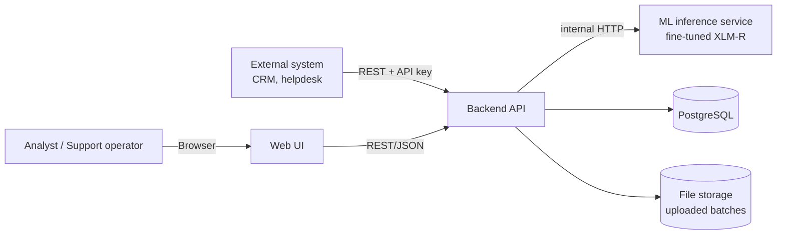

# KZ-RU Emotion Analysis

**Identifying emotions from text (sentiment analysis) for the Kazakh and Russian languages**
*Определение эмоций по тексту (анализ тональности) для казахского и русского языков*
*Мәтіннен эмоцияларды анықтау (көңіл-күйді талдау) қазақ және орыс тілдерінде*

| | |
|---|---|
| **Programme** | Software Engineering, Diploma Project 2026–2027 |
| **Group** | SE-2406 |
| **Supervisor** | Kamila Tanyrbergenova |
| **Team** | Nurgaly Ashkenov — ML/NLP Engineer · Ulan Orazbek — Backend Developer & System Integrator |
| **Issue tracker** | YouTrack project `DIP` — https://kz-ru-emotion.youtrack.cloud/projects/DIP |
| **Repository** | https://github.com/qulanoraz/kz-ru-emotion-analysis |
| **Current milestone** | Pre-defense 1 (probationary period 1) — materials submitted 22 October 2026, pre-defense 24 October 2026; tag **`prob-period-1`** (alias `pre-defense-1`, same commit) |
| **Status** | Analysis & design phase — all 11 artefacts in draft v1.0; first supervisor review held (SFB-01); user interviews and public-data analysis in progress; no application code yet |

---

## 1. Overview

Kazakhstani companies, government bodies and digital services receive thousands of reviews, appeals and comments every day in **Kazakh, Russian, and mixed Kazakh–Russian (code-switched)** text. Manual triage is slow and inconsistent, and most off-the-shelf emotion/sentiment tools are built for English or, at best, Russian; mature tooling for Kazakh is scarce.

This project delivers:

1. **An emotion classification model** for Kazakh, Russian and code-switched texts, based on fine-tuning a multilingual transformer (primary candidate: XLM-RoBERTa) and compared against classical and transformer baselines.
2. **A production-style web system** around the model: a REST API for single-text analysis, batch processing of uploaded files with aggregated emotion statistics, persistent storage in PostgreSQL, and a web dashboard with charts and exportable reports — containerised with Docker.

Emotion label set (MVP, single-label): `joy`, `sadness`, `anger`, `fear`, `surprise`, `neutral`.
Each prediction also returns a derived polarity (`positive` / `negative` / `neutral`), detected language (`kk` / `ru` / `mixed`) and class confidence scores.

### 1.1 Problem statement

There is no accessible, evaluated software solution that automatically identifies **emotions** (not only positive/negative polarity) in Kazakh, Russian and mixed Kazakh–Russian texts and integrates into organisational workflows. Major cloud APIs either do not support Kazakh sentiment at all or support only polarity, and the largest public Kazakh dataset (KazSAnDRA) is polarity-level and names code-switching as an open problem (see [DOC-03](docs/03-literature-review.md), [DOC-04](docs/04-existing-systems.md)).

### 1.2 Target users

| User | Need |
|---|---|
| Customer-support operators and team leads (banks, telecom, e-commerce, delivery) | Prioritise angry / frightened customers; weekly emotion trends |
| Social-media and brand-monitoring analysts | Emotional reaction to campaigns and events across channels |
| Service-quality analysts in the public sector | Emotion reports on citizen appeals without reading every message |
| Developers of CRM / helpdesk / chatbot systems | REST API returning emotion, language and confidence |

### 1.3 Expected outcomes

1. Annotated KZ / RU / mixed emotion corpus with guidelines and agreement statistics.
2. Fine-tuned XLM-RoBERTa model with a per-language-slice evaluation report against baselines.
3. ML inference service, REST API (single text + asynchronous batch), PostgreSQL storage.
4. Web dashboard with charts, filters and CSV/PDF export.
5. Docker Compose deployment, test reports, diploma thesis.

### 1.4 Scope

**In scope:** text-only, single-label 6-class emotion classification for Kazakh (Cyrillic, tolerant to common Latin transliteration), Russian and code-switched texts; language identification; REST API; batch files CSV/XLSX/TXT; dashboard and export; API-key auth; single-server Docker deployment.
**Out of scope:** speech/image emotion; other languages; sarcasm detection as a task; aspect-based emotion; real-time social-media ingestion; training LLMs from scratch. Full list: [DOC-01 §1.8](docs/01-project-proposal.md).

### 1.5 Selected technologies (proposed, see [DOC-05](docs/05-technology-comparison.md))

| Layer | Technology |
|---|---|
| ML | Python, Hugging Face Transformers, XLM-RoBERTa-base (primary), scikit-learn baselines |
| ML inference service | FastAPI + PyTorch (ONNX Runtime as optimisation) |
| Backend API | Python 3.11, FastAPI, Pydantic, SQLAlchemy 2.x, Alembic |
| Asynchronous jobs | Celery + Redis |
| Database | PostgreSQL 16 |
| Frontend | React + TypeScript (Vite), charting library |
| Diagrams | PlantUML (C4 + UML), sources in `docs/diagrams/src/` |
| Testing / CI | pytest, Locust, Playwright; GitHub Actions |
| Deployment | Docker, Docker Compose, Nginx |

### 1.6 Links

| Resource | Link |
|---|---|
| YouTrack project (board, tasks) | https://kz-ru-emotion.youtrack.cloud/projects/DIP |
| Documentation (11 artefacts) | [`docs/`](docs/) — see the map below |
| Prototype (wireframes) | [`docs/mockups/`](docs/mockups/), source [`docs/mockups/src/wireframes.html`](docs/mockups/src/wireframes.html) |
| API contract | [`docs/api/openapi.yaml`](docs/api/openapi.yaml) (open in https://editor.swagger.io) |
| Editable diagram sources | [`docs/diagrams/src/`](docs/diagrams/src/) |
| Consolidated report (PDF) | Built with `python scripts/build_report.py` |

## 2. Documentation map (pre-defense-1 deliverables)

| # | Artifact | File | Status |
|---|---|---|---|
| 1 | Project proposal | [`docs/01-project-proposal.md`](docs/01-project-proposal.md) | Draft v1.0 |
| 2 | Evidence of relevance | [`docs/02-evidence-of-relevance.md`](docs/02-evidence-of-relevance.md) | Draft v1.0 — desk research verified; interviews and public-data analysis in progress |
| 3 | Literature review | [`docs/03-literature-review.md`](docs/03-literature-review.md) | Draft v1.0 |
| 4 | Existing system comparison | [`docs/04-existing-systems.md`](docs/04-existing-systems.md) | Draft v1.0 |
| 5 | Technology comparison | [`docs/05-technology-comparison.md`](docs/05-technology-comparison.md) | Draft v1.0 |
| 6 | Requirements specification | [`docs/06-requirements.md`](docs/06-requirements.md) | Draft v1.0 |
| 7 | Architecture and diagrams | [`docs/07-architecture.md`](docs/07-architecture.md), [`docs/diagrams/`](docs/diagrams/) | Draft v1.0 (11 diagrams) |
| 8 | UX / prototype & API contracts | [`docs/08-ux-prototype.md`](docs/08-ux-prototype.md), [`docs/api/`](docs/api/), [`docs/mockups/`](docs/mockups/) | Draft v1.0 |
| 9 | Verification and evaluation plan | [`docs/09-verification-plan.md`](docs/09-verification-plan.md) | Draft v1.0 |
| 10 | Project management and risks | [`docs/10-project-management.md`](docs/10-project-management.md) | Draft v1.0 |
| 11 | Supervisor feedback log | [`docs/11-supervisor-feedback.md`](docs/11-supervisor-feedback.md) | v1.1 — SFB-01 (21.10.2026) logged |

## 3. Repository structure

```text
kz-ru-emotion-analysis/
├── README.md                       # This file: overview, structure, conventions
├── .gitignore
├── .env.example                    # Template of environment variables (no secrets)
├── docker-compose.yml              # Local stack: backend, ml-service, postgres, frontend
├── Makefile                        # Shortcuts: make up / test / lint / train
│
├── docs/                           # All pre-defense documentation
│   ├── 01-project-proposal.md
│   ├── 02-evidence-of-relevance.md
│   ├── 03-literature-review.md
│   ├── 04-existing-systems.md
│   ├── 05-technology-comparison.md
│   ├── 06-requirements.md
│   ├── 07-architecture.md
│   ├── 08-ux-prototype.md
│   ├── 09-verification-plan.md
│   ├── 10-project-management.md
│   ├── 11-supervisor-feedback.md
│   ├── api/
│   │   └── openapi.yaml            # REST API contract (source of truth)
│   ├── diagrams/
│   │   ├── src/                    # Editable sources: *.puml (PlantUML, incl. C4)
│   │   └── export/                 # Rendered PNG/SVG committed for reviewers
│   ├── mockups/                    # Wireframes SCR-01…06 (PNG); src/wireframes.html
│   ├── evidence/
│   │   ├── interview-guide.md
│   │   ├── consent-form.md
│   │   ├── interviews/             # Anonymised notes only (INT-01.md …)
│   │   └── data-analysis/          # Public-data sample analysis notebooks/reports
│   ├── literature/
│   │   └── references.bib          # BibTeX of all cited sources
│   ├── pm/
│   │   └── backlog.csv             # YouTrack backlog (generated by scripts/backlog.py)
│   └── supervisor/                 # Minutes of review sessions SFB-xx
│
├── ml/                             # ML/NLP workstream (owner: Nurgaly)
│   ├── data/
│   │   ├── raw/                    # Original data — NOT committed (gitignored)
│   │   ├── interim/                # Cleaned / merged — NOT committed
│   │   ├── processed/              # Train/val/test splits — NOT committed
│   │   └── README.md               # Data sources, licences, how to reproduce
│   ├── annotation/
│   │   ├── guidelines.md           # Labelling guidelines v0 (DIP-18) with KZ/RU/mixed examples
│   │   └── agreement/              # Inter-annotator agreement reports
│   ├── notebooks/                  # EDA and experiments (01-eda.ipynb …)
│   ├── src/
│   │   ├── preprocessing/          # Normalisation, Cyrillic/Latin KZ handling, lang-id
│   │   ├── training/               # Fine-tuning scripts (transformers)
│   │   ├── evaluation/             # Metrics per language slice, confusion matrices
│   │   └── baselines/              # TF-IDF + LogReg, mBERT, etc.
│   ├── configs/                    # YAML experiment configs
│   ├── models/                     # Checkpoints — NOT committed
│   ├── reports/                    # Experiment results tables / figures
│   └── requirements.txt
│
├── ml-service/                     # Model inference microservice
│   ├── app/
│   ├── tests/
│   ├── Dockerfile
│   └── requirements.txt
│
├── backend/                        # Core REST API (owner: Ulan)
│   ├── app/
│   │   ├── api/                    # Routers: /analyze, /batches, /reports
│   │   ├── core/                   # Config, security, logging
│   │   ├── db/                     # SQLAlchemy models, session
│   │   ├── schemas/                # Pydantic request/response models
│   │   ├── services/               # Business logic, ML-service client, batch jobs
│   │   └── main.py
│   ├── migrations/                 # Alembic migrations
│   ├── tests/
│   │   ├── unit/
│   │   ├── integration/
│   │   └── load/                   # Locust / k6 scenarios
│   ├── Dockerfile
│   └── requirements.txt
│
├── frontend/                       # Web UI: upload, dashboard, reports
│   ├── src/
│   ├── public/
│   ├── Dockerfile
│   └── package.json
│
├── scripts/
│   ├── backlog.py                  # Backlog → YouTrack CSV, DOC-10 tables, roadmap Gantt
│   ├── check_openapi.py            # Validates openapi.yaml and all JSON examples
│   └── render_mockups.py           # Renders wireframes to PNG (Playwright)
│
└── .github/
    ├── workflows/
    │   └── ci.yml                  # Lint + tests on every PR
    └── PULL_REQUEST_TEMPLATE.md
```

> Technology choices shown above (FastAPI, SQLAlchemy/Alembic, PostgreSQL, Celery/Redis, React, Docker, transformers) are **proposed** and awaiting supervisor confirmation (DOC-11, Q5). Alternatives and the justification are documented in [`docs/05-technology-comparison.md`](docs/05-technology-comparison.md).

## 4. Planned system (high level)



## 5. Getting started

### 5.1 What can be run and tested now (pre-defense-1)

There is no application code yet; the runnable parts are the documentation tooling and the contract test. Requirements: Python 3.11+, Java 11+ and Graphviz (only for diagrams).

```bash
git clone https://github.com/qulanoraz/kz-ru-emotion-analysis && cd kz-ru-emotion-analysis
python -m venv .venv && source .venv/bin/activate      # Windows: .venv\Scripts\activate
pip install -r requirements-dev.txt

pytest                                    # automated tests: OpenAPI contract + backlog consistency
python scripts/check_openapi.py docs/api/openapi.yaml   # validate API contract and all JSON examples
python scripts/backlog.py                 # regenerate YouTrack CSV, DOC-10 tables and roadmap
java -jar tools/plantuml.jar -tsvg -o ../export docs/diagrams/src/*.puml   # re-render diagrams
python scripts/build_report.py            # build consolidated PDF of all 11 sections (needs Playwright)
```

The same tests run in GitHub Actions on every pull request (`.github/workflows/ci.yml`).

### 5.2 Target workflow (after implementation tasks DIP-26…DIP-39)

> The commands below describe the intended developer workflow and will work once the corresponding DIP tasks are completed.

```bash
git clone <repo-url> && cd kz-ru-emotion-analysis
cp .env.example .env            # fill in local values
docker compose up --build       # backend :8000, ml-service :8001, frontend :3000, postgres :5432
```

ML experiments:

```bash
cd ml
python -m venv .venv && source .venv/bin/activate
pip install -r requirements.txt
python -m src.training.train --config configs/xlmr_base.yaml
```

## 6. Development conventions

### 6.1 Branching

- `main` — stable, protected; changes only via reviewed Pull Requests.
- `develop` — integration branch.
- Feature branches are created from `develop` and named after the YouTrack issue:
  `DIP-<number>-<short-kebab-description>`
  Examples: `DIP-32-batch-upload-endpoint`, `DIP-21-kazakh-text-normalizer`, `DIP-5-literature-review`.

### 6.2 Commit messages

Format: `DIP-<number>: <imperative summary>` (≤ 72 chars), optional body explaining *why*.

```text
DIP-32: add POST /api/v1/batches endpoint with CSV validation
DIP-21: normalize Kazakh-specific Cyrillic letters before tokenization
DIP-3: add project proposal draft v1
```

Mentioning the issue ID lets YouTrack link every commit to its task (traceability).

### 6.3 Pull Requests

- One PR per DIP task; title `DIP-XX: <summary>`.
- At least one approving review from the other team member.
- CI (lint + tests) must pass before merge.
- Documentation PRs touching key artifacts are also sent to the supervisor; feedback is logged in [`docs/11-supervisor-feedback.md`](docs/11-supervisor-feedback.md).

### 6.4 Tags / milestones

| Tag | Date | Content |
|---|---|---|
| `prob-period-1` (= `pre-defense-1`) | 24.10.2026 | Analysis, design, requirements, backlog, repository skeleton. Two tags on the same commit: `prob-period-1` is required by the submission form, `pre-defense-1` by the repository requirements |
| `pre-defense-2` | ≈ 20.03.2027 (set by department) | Working MVP: trained model + single/batch API |
| `final-defense` | ≈ 12.06.2027 (set by department) | Complete system, evaluation report, thesis |

### 6.5 Data and ethics

- Raw datasets, personal data and model checkpoints are **never** committed (see `.gitignore`).
- Collected texts are anonymised (names, phone numbers, IINs, e-mails removed) before annotation.
- Third-party datasets are used only under their licences; sources are listed in `ml/data/README.md`.
- Interview notes are stored anonymised (`INT-01 … INT-05`) with respondents' consent.

## 7. Team responsibilities

| Area | Nurgaly Ashkenov (ML/NLP) | Ulan Orazbek (Backend/Integration) |
|---|---|---|
| Data | Collection, annotation guidelines, labelling, splits | Batch file formats, storage schema |
| Model | Preprocessing for Kazakh morphology, fine-tuning, baselines, evaluation | Model serving integration, latency budget |
| System | Inference service logic | Architecture, REST API, PostgreSQL, web UI, Docker, deployment |
| Quality | ML metrics (Macro-F1 per language slice) | Unit/integration/load tests, CI |
| Docs | Literature review, evaluation plan (ML part) | Requirements, architecture, API spec, PM |

## 8. License

Academic project. License to be confirmed with the supervisor (default: MIT for code; datasets under their original licences).
