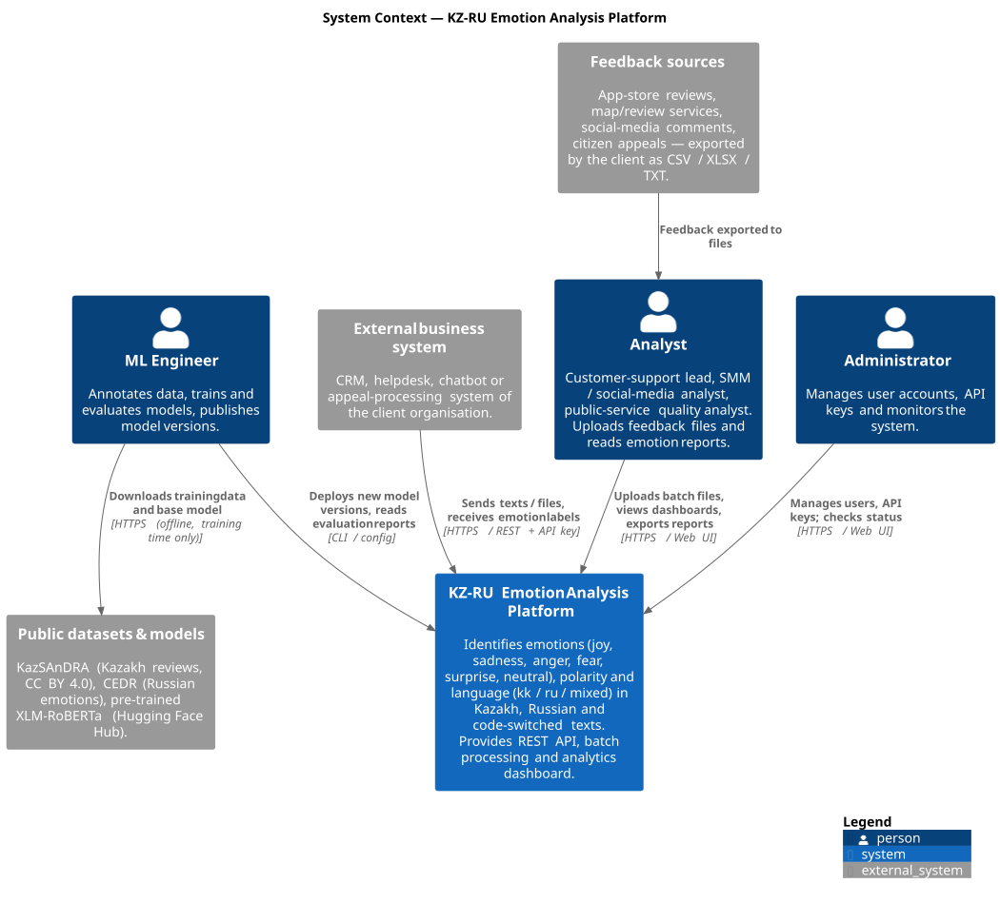
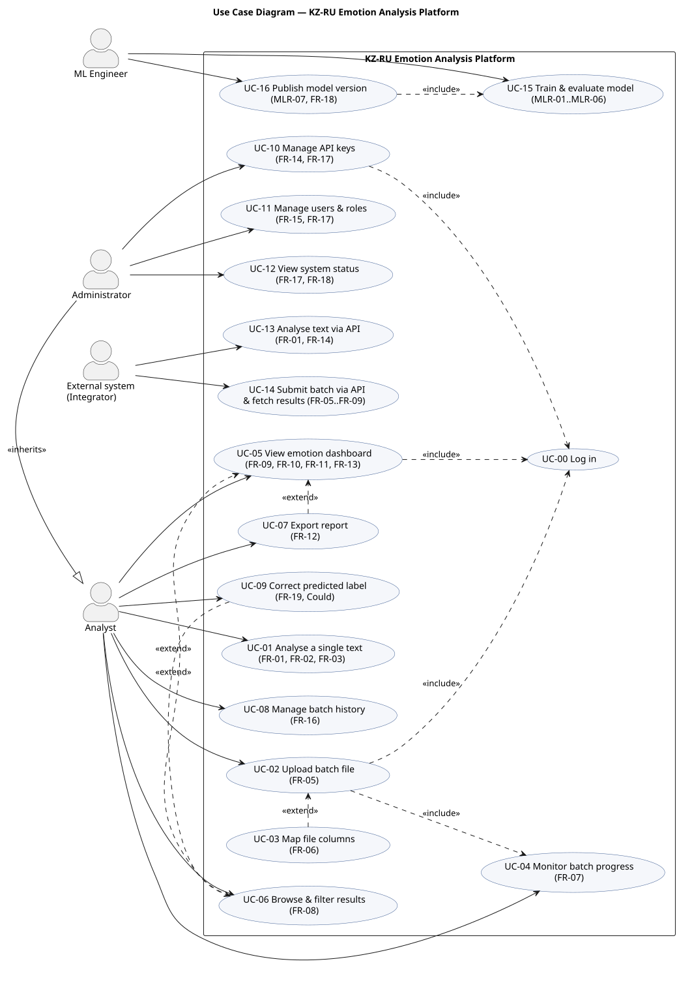
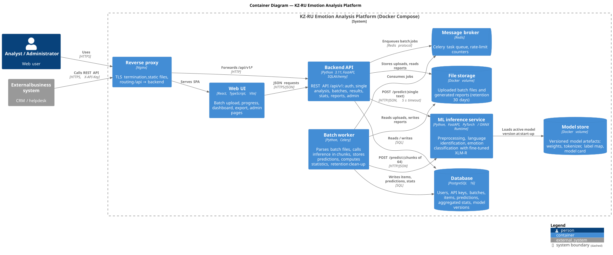
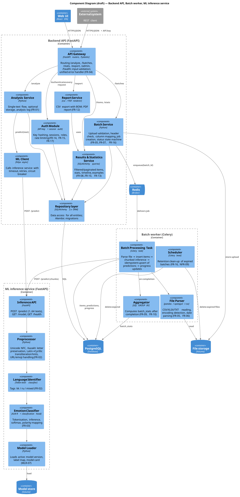
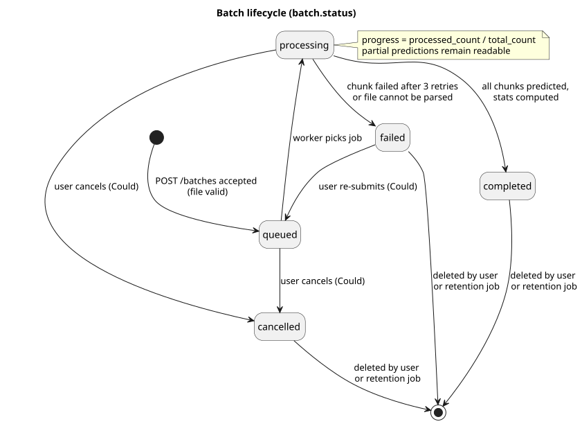
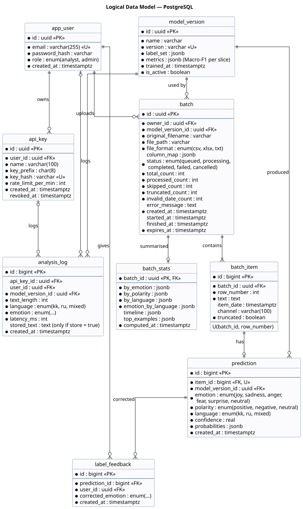
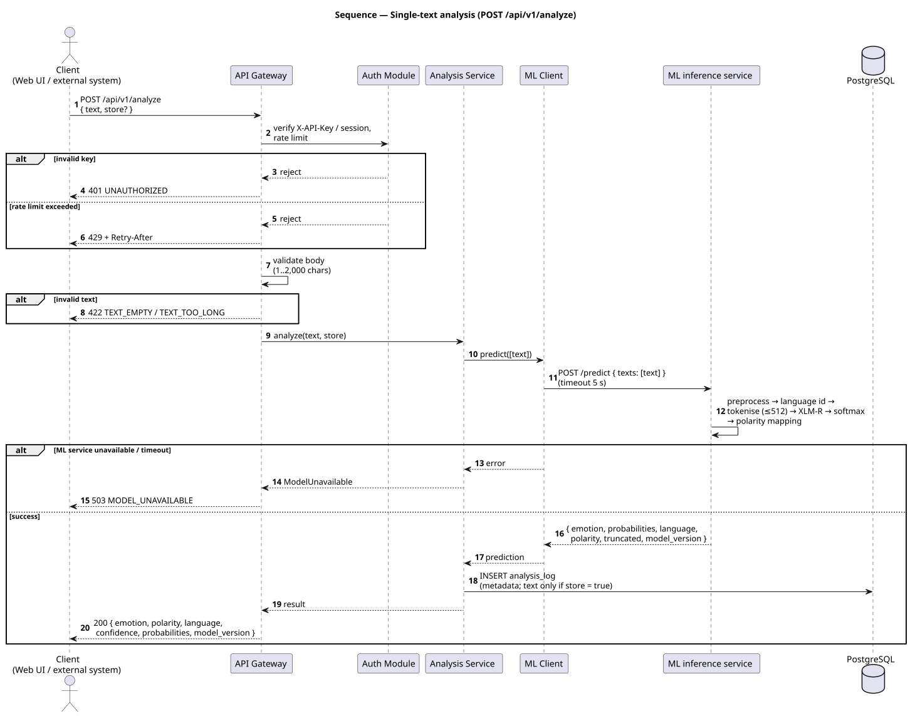
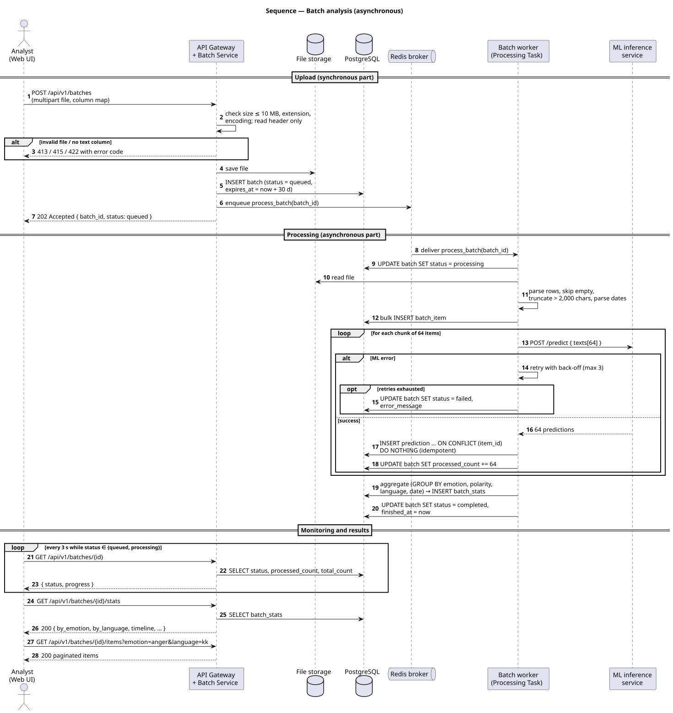
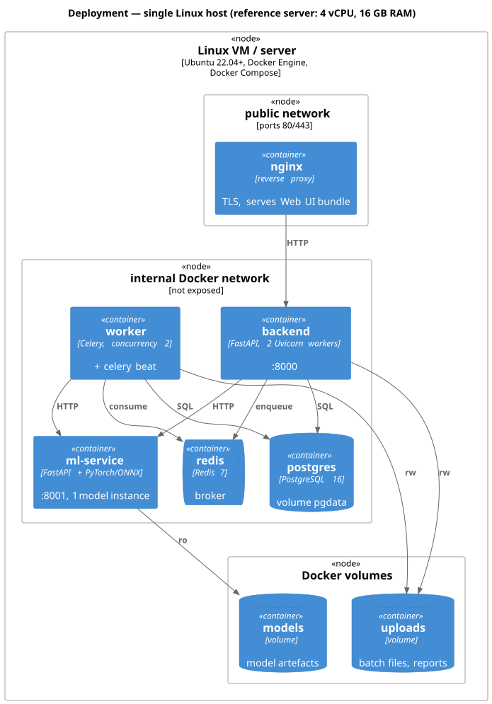
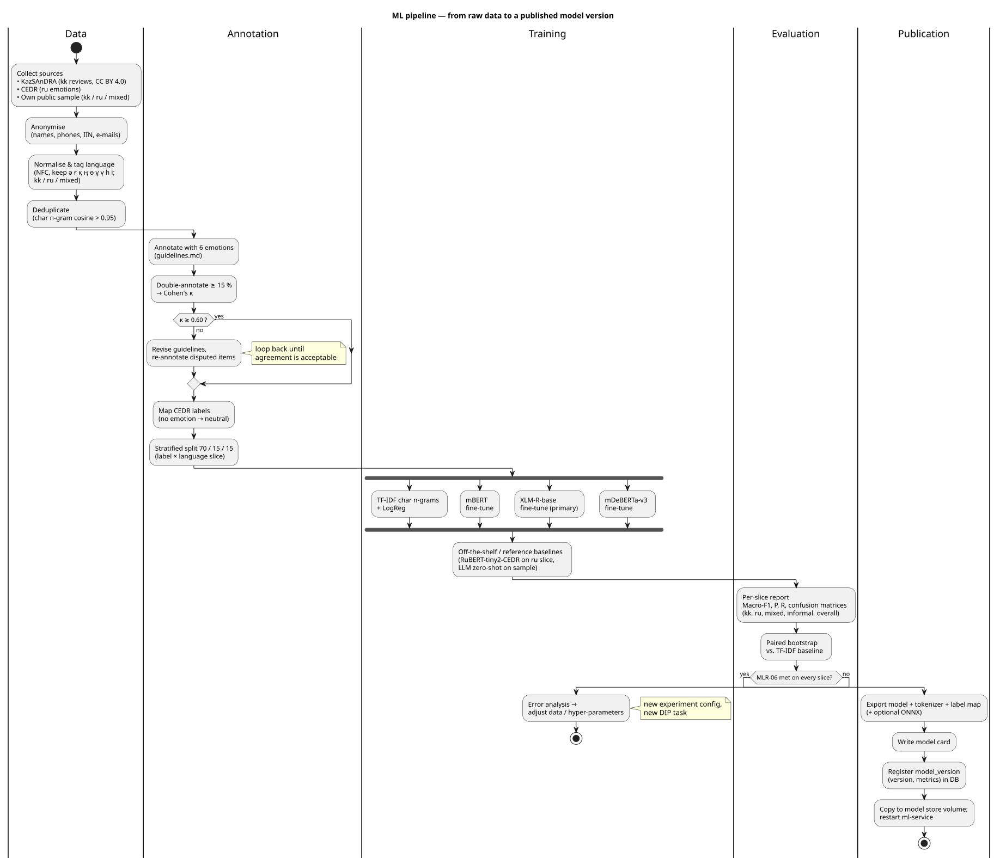

# 7. Architecture and Diagrams

**Document ID:** DOC-07 · **Version:** 1.0 (draft for pre-defense-1) · **Date:** 20.10.2026
**YouTrack:** DIP-10 (architecture), DIP-11 (diagrams) · **Owner:** Ulan Orazbek (lead), Nurgaly Ashkenov (ML service, ML pipeline) · **Reviewer:** K. Tanyrbergenova
**Related:** DOC-05 (technology decisions TD-1…TD-5), DOC-06 (FR / NFR / MLR), DOC-08 (API contracts), DOC-09 (tests)

---

## 7.1 Purpose and notation

This document describes the architecture of the KZ-RU Emotion Analysis Platform at four levels of detail, following the **C4 model** (Context → Containers → Components) complemented by UML use-case, sequence, state and data-model diagrams.

All diagrams are kept as **editable text sources** in [`docs/diagrams/src/`](diagrams/src/) (PlantUML, `.puml`) and as rendered images in [`docs/diagrams/export/`](diagrams/export/) (SVG + PNG). The sources are the single source of truth; images are regenerated from them (see [`docs/diagrams/README.md`](diagrams/README.md)). Component and entity names in the diagrams are **identical** to those used in the traceability matrix of DOC-06 §6.7, so every requirement can be followed from text to diagram.

| # | Diagram | Source | Section |
|---|---|---|---|
| D1 | System context (C4 L1) | `01-system-context.puml` | §7.3 |
| D2 | Use cases | `02-use-case.puml` | §7.4 |
| D3 | Containers (C4 L2) | `03-container.puml` | §7.5 |
| D4 | Components (C4 L3, draft) | `04-component.puml` | §7.6 |
| D5 | Batch lifecycle state machine | `08-batch-states.puml` | §7.7 |
| D6 | Logical data model (ER) | `05-er.puml` | §7.8 |
| D7 | Sequence — single-text analysis | `06-seq-single.puml` | §7.9.1 |
| D8 | Sequence — batch analysis | `07-seq-batch.puml` | §7.9.2 |
| D9 | Deployment | `09-deployment.puml` | §7.10 |
| D10 | Offline ML pipeline | `10-ml-pipeline.puml` | §7.11 |

## 7.2 Architectural drivers and style

### 7.2.1 Drivers

| Driver | Source | Architectural consequence |
|---|---|---|
| Interactive single-text analysis with p95 ≤ 1 s | NFR-01 | Synchronous path API → ML service, no queue; model kept warm in memory |
| Batch files up to 50,000 items without blocking the API | FR-07, NFR-02, AC-07.3 | Asynchronous processing by separate worker processes via message broker |
| Heavy, independently versioned model | MLR-07, DD8 | Model isolated in its own **ML inference service** with a stable internal contract |
| Ownership split between two developers | Team constraint | Service boundary = team boundary: Nurgaly owns ML service + pipeline, Ulan owns backend, worker, UI, infrastructure |
| Fast dashboards on large batches | FR-09, NFR-03 | Statistics pre-aggregated once per batch into `batch_stats` |
| Self-hosted, privacy-sensitive users | DD5, NFR-09, NFR-12 | Single-host Docker Compose; no external calls at run time; retention job |
| Fault tolerance of long batches | NFR-05 | Chunked processing, retries, idempotent writes |

### 7.2.2 Style

The system is a **modular service-oriented architecture with three runtime services** — Backend API, Batch worker and ML inference service — plus infrastructure containers (PostgreSQL, Redis, Nginx). This is deliberately *not* a fine-grained microservice architecture: for a two-person team, splitting further (e.g., a separate statistics or auth service) would add deployment and consistency cost without satisfying any additional requirement. Inside the Backend API, a **layered structure** is used: routers (API Gateway) → services (business logic) → repository (data access).

Key patterns:

| Pattern | Where | Why |
|---|---|---|
| Layered architecture | Backend API | Testability: services are unit-tested without HTTP or DB |
| Asynchronous job queue (producer–consumer) | Batch Service → Redis → Batch worker | FR-07, NFR-02 |
| Idempotent consumer | `INSERT … ON CONFLICT (item_id) DO NOTHING` | NFR-05: a retried chunk never duplicates predictions |
| Timeout + retry + circuit breaker | ML Client, Batch Processing Task | AC-04.5, AC-07.4 |
| Pre-computed aggregates (materialised read model) | Aggregator → `batch_stats` | AC-09.3, NFR-03 |
| Contract-first API (OpenAPI generated from code) | API Gateway | NFR-11, DOC-08 |

## 7.3 System context (D1)

| Element | Type | Interaction with the platform |
|---|---|---|
| Analyst | Person | Uploads batch files, monitors processing, reads dashboards, exports reports (Web UI over HTTPS) |
| Administrator | Person | Manages users and API keys, checks status (Web UI) |
| ML Engineer | Person | Trains and evaluates models offline; deploys a new model version to the model store |
| External business system | Software system | Sends texts or files and receives labels via REST + API key |
| Feedback sources | Software systems | Not integrated directly; their exports reach the platform as files (real-time ingestion is Won't, FR-21) |
| Public datasets & models | Software systems | Used only at **training time**; the running platform has no outbound dependency on them |

**System boundary decision.** The platform does not connect to social networks, app stores or CRMs on its own. All input enters through two doors — file upload and REST API — which keeps the scope realistic (DOC-01 §1.8) and avoids handling third-party credentials. Won't-requirements FR-20 (multi-label), FR-21 (real-time ingestion) and FR-22 (aspect-based emotion) therefore have no components in this architecture; FR-20 can be added later without structural change because the ML contract already returns the full probability vector.

## 7.4 Use cases (D2)

| UC | Name | Primary actor | Requirements | Main success scenario (short) |
|---|---|---|---|---|
| UC-00 | Log in | Analyst, Admin | FR-15 | Enter e-mail and password → session created |
| UC-01 | Analyse a single text | Analyst | FR-01–FR-04 | Paste text → see emotion, polarity, language, confidence bars |
| UC-02 | Upload batch file | Analyst | FR-05 | Drop CSV/XLSX/TXT → file validated → batch queued |
| UC-03 | Map file columns | Analyst | FR-06 | Choose text / date / channel columns from detected headers |
| UC-04 | Monitor batch progress | Analyst | FR-07 | See status and progress bar update until `completed` |
| UC-05 | View emotion dashboard | Analyst | FR-09–FR-11, FR-13 | Charts by emotion, polarity, language, time; examples |
| UC-06 | Browse & filter results | Analyst | FR-08 | Filter table by emotion / language / confidence |
| UC-07 | Export report | Analyst | FR-12 | Download CSV (PDF — Could) |
| UC-08 | Manage batch history | Analyst | FR-16 | List and delete own batches |
| UC-09 | Correct predicted label | Analyst | FR-19 (Could) | Change label of an item; correction stored for retraining |
| UC-10 | Manage API keys | Admin | FR-14, FR-17 | Create key (shown once), revoke key |
| UC-11 | Manage users & roles | Admin | FR-15, FR-17 | Create user, assign role, deactivate |
| UC-12 | View system status | Admin | FR-17, FR-18 | Model version, queue length, health |
| UC-13 | Analyse text via API | Integrator | FR-01, FR-14 | `POST /analyze` with API key → JSON result |
| UC-14 | Submit batch via API and fetch results | Integrator | FR-05–FR-09 | `POST /batches` → poll status → `GET /items`, `/stats` |
| UC-15 | Train & evaluate model | ML Engineer | MLR-01–MLR-06 | Run pipeline from config → per-slice report |
| UC-16 | Publish model version | ML Engineer | MLR-07, FR-18 | Register version, place artefacts, restart ML service |

Administrator **inherits** all Analyst use cases. UC-02 includes UC-04 (every upload is followed by monitoring); UC-03, UC-06, UC-07 and UC-09 are optional extensions of their base use cases.

## 7.5 Containers (D3)

| Container | Technology (DOC-05) | Responsibility | Owner | Scales by |
|---|---|---|---|---|
| Reverse proxy | Nginx | TLS, static Web UI bundle, routing `/api/v1/*`, upload size limit (10 MB) | Ulan | — |
| Web UI | React + TypeScript (TD-5) | All user screens (DOC-08); typed API client generated from OpenAPI | Ulan | Static files |
| Backend API | FastAPI, SQLAlchemy (TD-1) | Public REST API, auth, validation, orchestration, reads for dashboards | Ulan | Uvicorn workers |
| Batch worker | Celery (TD-3) | Long-running batch processing, aggregation, retention clean-up | Ulan | Worker concurrency / replicas |
| ML inference service | FastAPI + PyTorch / ONNX Runtime (TD-3, TD-4) | Preprocessing, language identification, emotion classification | Nurgaly | Replicas (one model instance each) |
| Database | PostgreSQL 16 (TD-2) | System of record for all entities (§7.8) | Ulan | Vertical |
| Message broker | Redis 7 | Celery queue; rate-limit counters | Ulan | — |
| File storage | Docker volume | Uploaded files and generated reports; deleted with the batch | Ulan | Disk |
| Model store | Docker volume (read-only for ML service) | Versioned model artefacts | Nurgaly | Disk |

### 7.5.1 Internal contract between Backend and ML inference service

The ML service is reachable only from the internal Docker network. Its contract is small and stable, so the two workstreams can progress in parallel against a mock (DIP-27):

| Endpoint | Request | Response |
|---|---|---|
| `POST /predict` | `{ "texts": [string, 1..64] }` | `{ "model_version": str, "predictions": [ { "emotion", "probabilities"{6}, "polarity", "language", "truncated" } ] }` — same order as input |
| `GET /model` | — | name, version, label set, trained_at, metrics per slice |
| `GET /health` | — | `{ "status": "ok", "model_loaded": true }` |

Full JSON examples of the public API are given in DOC-08.

## 7.6 Components (D4, draft)

| Container | Component | Responsibility | Requirements |
|---|---|---|---|
| Backend API | **API Gateway** | Routers for all `/api/v1` endpoints; Pydantic validation; unified error schema; OpenAPI generation | FR-04, FR-18, NFR-11 |
| | **Auth Module** | API-key hashing and lookup, sessions, roles, rate limiting; admin endpoints for keys and users | FR-14, FR-15, FR-17 |
| | **Analysis Service** | Single-text flow; writes `analysis_log`; stores text only if `store = true` | FR-01, NFR-09 |
| | **Batch Service** | Upload checks (size, type, encoding, header), column mapping, batch creation, enqueuing, state transitions, deletion | FR-05–FR-07, FR-16 |
| | **Results & Statistics Service** | Paginated / filtered items, reading `batch_stats`, timeline, top examples, label corrections | FR-08–FR-10, FR-13, FR-19 |
| | **Report Service** | CSV export (UTF-8 BOM); PDF report (Could) | FR-12 |
| | **ML Client** | Async HTTP client to ML service; 5 s timeout, 3 retries, circuit breaker | AC-04.5 |
| | **Repository layer** | ORM mappings, queries, Alembic migrations | All data |
| Batch worker | **Batch Processing Task** | Orchestrates parsing, chunked inference, idempotent writes, progress | FR-07, NFR-05 |
| | **File Parser** | CSV / XLSX / TXT reading, encoding detection, date parsing, truncation | FR-05, FR-06 |
| | **Aggregator** | Computes `batch_stats` once a batch is complete | FR-09, FR-10 |
| | **Scheduler** | Celery beat job deleting expired batches and files | FR-16, NFR-09 |
| ML inference service | **Inference API** | `/predict`, `/model`, `/health`; batching of up to 64 texts | FR-01, FR-18 |
| | **Preprocessor** | Unicode NFC, preservation of Kazakh letters, URL / e-mail / emoji normalisation, hints for Latin-script Kazakh | FR-02, AC-02.4 |
| | **Language Identifier** | Token-level kk / ru decision → item tag kk / ru / mixed | FR-02 |
| | **Emotion Classifier** | Tokenisation (≤ 512), XLM-R forward pass, softmax, polarity mapping | FR-03 |
| | **Model Loader** | Loads active version, label map and model card from the model store | MLR-07 |

*Draft status:* component boundaries inside the Backend API may be merged or split during implementation; the container boundaries and the internal ML contract (§7.5.1) are considered stable.

## 7.7 Batch lifecycle (D5)

| From → To | Trigger | Guard / action |
|---|---|---|
| — → `queued` | `POST /batches` accepted | File passed size, type, encoding and header checks |
| `queued` → `processing` | Worker takes job | `started_at` set |
| `processing` → `completed` | Last chunk stored | Aggregator wrote `batch_stats`; `finished_at` set |
| `processing` → `failed` | Chunk failed 3 times, or file unparseable | `error_message` set; stored predictions remain readable |
| `queued`/`processing` → `cancelled` | User cancels (Could) | Worker stops after current chunk |
| `failed` → `queued` | User re-submits (Could) | Only unpredicted items are processed again |
| any final → deleted | User deletes, or `expires_at` passed | File, items, predictions, stats removed (cascade) |

Any other transition is rejected by the Batch Service (AC-07.2) and covered by a unit test of the state model.

## 7.8 Data model (D6)

| Entity | Purpose | Written by | Read by |
|---|---|---|---|
| `app_user` | Web users and roles | Auth Module | Auth Module |
| `api_key` | Hashed API keys, per-key rate limit | Auth Module | Auth Module |
| `model_version` | Registered models with label set and per-slice metrics | ML Engineer (UC-16) | Analysis Service, `/model` |
| `batch` | One uploaded file, its status and counters | Batch Service, Batch worker | All batch endpoints |
| `batch_item` | One text row from the file (with optional date, channel) | Batch worker | Results & Statistics |
| `prediction` | Model output for one item (1:1 with item) | Batch worker | Results & Statistics, Report |
| `batch_stats` | Pre-aggregated statistics for dashboard | Aggregator | Results & Statistics |
| `label_feedback` | Analyst corrections (Could) | Results & Statistics | ML pipeline export |
| `analysis_log` | Metadata of single-text calls; text only if opted in | Analysis Service | Admin status, NFR measurements |

**Key design decisions**

- **Probabilities as JSONB.** The vector of six probabilities is always read together and never filtered by individual values, so JSONB avoids six extra columns while keeping the schema stable if the label set changes in a future model version.
- **Separate `prediction` table** instead of columns in `batch_item`: makes re-prediction with a new `model_version` possible later and keeps the raw text table immutable.
- **Indexes:** `batch_item(batch_id, row_number)` unique; `prediction(item_id)` unique (idempotency); `prediction(emotion, language)` and `batch_item(batch_id, item_date)` for filters and timeline; `batch(owner_id, created_at)` for history; `batch(expires_at)` for the retention job.
- **Cascading deletes** from `batch` to `batch_item`, `prediction`, `batch_stats`, implementing AC-16.2 in one statement.
- **Personal data:** only `batch_item.text` and the optional `analysis_log.stored_text` may contain personal data; both are covered by retention (NFR-09).

## 7.9 Runtime scenarios

### 7.9.1 Single-text analysis (D7) — UC-01 / UC-13

The request is handled synchronously. The latency budget for NFR-01 (p95 ≤ 1,000 ms on CPU) is allocated as follows and verified per component in TC-LOAD-01:

| Step | Budget (p95) |
|---|---|
| Proxy + auth + validation | ≤ 30 ms |
| Backend → ML service network hop | ≤ 10 ms |
| Preprocessing + language identification | ≤ 30 ms |
| XLM-R-base inference, 1 text ≤ 500 chars, CPU | ≤ 800 ms *(to be measured in DIP-26)* |
| Logging + response serialisation | ≤ 30 ms |
| **Total** | **≤ 900 ms + 10 % margin** |

If the measured inference time exceeds its budget, the mitigation path is ONNX Runtime with dynamic INT8 quantisation (DOC-05 TD-3), then a distilled model; the change is logged in DOC-11.

### 7.9.2 Batch analysis (D8) — UC-02, UC-04, UC-05 / UC-14

The upload request performs only cheap checks (size, type, encoding, header) and returns `202 Accepted` within about a second; all parsing and inference happen in the worker. Processing is done in **chunks of 64 items**, which (a) amortises transformer overhead, (b) bounds memory, (c) gives fine-grained progress, and (d) limits the work lost on a failure to one chunk. Because predictions are written with `ON CONFLICT (item_id) DO NOTHING`, a chunk retried after a crash never creates duplicates (NFR-05, TC-INT-09).

## 7.10 Deployment (D9)

| Aspect | Decision |
|---|---|
| Topology | One Linux host, Docker Compose; only Nginx publishes ports (80/443) |
| Configuration | Environment variables from `.env` (template `.env.example`); no secrets in images or Git |
| Persistence | Named volumes `pgdata`, `uploads`, `models`; database backup by `pg_dump` cron (Should) |
| Restart policy | `unless-stopped` for all services; health checks in Compose |
| Model update | Copy new version to `models` volume → update `ACTIVE_MODEL_VERSION` → restart `ml-service` (≈ 1 min downtime of analysis only; queued batches wait) |
| CI | GitHub Actions: lint, unit tests, OpenAPI drift check, image build on every PR to `develop` |
| Scale-up path | Add `ml-service` replicas behind the internal network, or move it to a GPU host; no code change needed thanks to the HTTP contract |

## 7.11 Offline ML pipeline (D10)

The training pipeline is **outside** the runtime system: it runs on a GPU machine (Colab-class or university server), and its only output into the platform is a versioned model artefact plus a `model_version` record. This separation means that experiments never affect the running service and that the platform can be demonstrated with any model version, including an early baseline.

| Stage | Output artefact | Location | Requirement |
|---|---|---|---|
| Collection, anonymisation, normalisation, dedup | `interim/*.jsonl` | `ml/data/interim/` (not in Git) | MLR-08 |
| Annotation and agreement | labelled corpus, κ report | `ml/data/processed/`, `ml/annotation/agreement/` | MLR-02 |
| Stratified split | `train/val/test` | `ml/data/processed/` | MLR-03, MLR-04 |
| Training of model grid | checkpoints, run config | `ml/models/` (not in Git) | MLR-01 |
| Evaluation | per-slice tables, confusion matrices | `ml/reports/` (in Git) | MLR-05, MLR-06 |
| Publication | model + tokenizer + label map + model card | model store volume; `model_version` row | MLR-07, NFR-17 |

## 7.12 Cross-cutting concerns

| Concern | Approach | Requirements |
|---|---|---|
| Authentication | API key in `X-API-Key` (hashed, prefix for lookup) for integrators; session cookie (HttpOnly, SameSite=Lax) for Web UI | FR-14, FR-15 |
| Authorisation | Role check in Auth Module; ownership filter on every batch query (`owner_id = current_user` unless admin) | AC-08.4, AC-15.3 |
| Input safety | Size limits at Nginx and API; strict file-type allow-list; ORM-only SQL; formula-injection escaping of `=`, `+`, `-`, `@` at the start of cells in CSV export | NFR-08 |
| Privacy | No text storage for single calls by default; retention job; no full texts in logs; anonymisation before annotation | NFR-09 |
| Error handling | One error schema; mapped exceptions (422, 401, 404, 413, 415, 429, 503); no stack traces to clients | FR-04 |
| Observability | JSON logs with `request_id` propagated API → worker → ML service; `/metrics` counters and latency histograms | NFR-15 |
| Localisation | UI strings in RU/EN resource files; UTF-8 everywhere; BOM in CSV exports for Excel | NFR-14 |
| Reproducibility | Model version in every prediction and response; experiment configs and seeds in Git | MLR-01, AC-01.2 |

## 7.13 Consistency check: requirements ↔ use cases ↔ components ↔ data

This table is the architectural answer to *"are requirements, components, data and user scenarios consistent with each other?"*. Every Must requirement appears in at least one use case, is realised by at least one component and, where it handles data, maps to an entity. Gaps would be shown as **✘**; none remain for Must requirements.

| Req. | Priority | Use case(s) | Component(s) | Entity | Sequence | Status |
|---|---|---|---|---|---|---|
| FR-01 | Must | UC-01, UC-13 | API Gateway, Analysis Service, ML Client, Inference API, Emotion Classifier | analysis_log | D7 | ✔ |
| FR-02 | Must | UC-01, UC-13, UC-14 | Preprocessor, Language Identifier | prediction.language | D7, D8 | ✔ |
| FR-03 | Must | UC-01, UC-13 | Emotion Classifier | prediction.probabilities, polarity | D7 | ✔ |
| FR-04 | Must | UC-01, UC-02, UC-13, UC-14 | API Gateway, ML Client | — | D7, D8 | ✔ |
| FR-05 | Must | UC-02, UC-14 | Batch Service, File Parser | batch, batch_item | D8 | ✔ |
| FR-06 | Should | UC-03 | Batch Service, File Parser | batch.column_map | D8 | ✔ |
| FR-07 | Must | UC-04, UC-14 | Batch Service, Batch Processing Task | batch.status, processed_count | D8, D5 | ✔ |
| FR-08 | Must | UC-06, UC-14 | Results & Statistics Service | batch_item, prediction | D8 | ✔ |
| FR-09 | Must | UC-05, UC-14 | Aggregator, Results & Statistics Service | batch_stats | D8 | ✔ |
| FR-10 | Should | UC-05 | Aggregator, Results & Statistics Service | batch_item.item_date, batch_stats.timeline | D8 | ✔ |
| FR-11 | Must | UC-05 | Web UI | — | — (UI flow in DOC-08) | ✔ |
| FR-12 | Must / Could | UC-07 | Report Service | — | — | ✔ |
| FR-13 | Should | UC-05 | Results & Statistics Service, Aggregator | batch_stats.top_examples | — | ✔ |
| FR-14 | Must | UC-10, UC-13, UC-14 | Auth Module | api_key | D7 | ✔ |
| FR-15 | Must / Should | UC-00, UC-11 | Auth Module | app_user | — | ✔ |
| FR-16 | Should | UC-08 | Batch Service, Scheduler | batch.expires_at | D5 | ✔ |
| FR-17 | Should | UC-10, UC-11, UC-12 | Auth Module (admin endpoints) | api_key, app_user | — | ✔ |
| FR-18 | Must | UC-12, UC-16 | API Gateway, Inference API, Model Loader | model_version | — | ✔ |
| FR-19 | Could | UC-09 | Results & Statistics Service | label_feedback | — | ✔ |
| MLR-01…08 | Must | UC-15, UC-16 | Offline ML pipeline, Model Loader | model_version | D10 | ✔ |
| NFR-01 | Must | UC-01, UC-13 | Synchronous path (§7.9.1) | — | D7 | ✔ budget §7.9.1 |
| NFR-02, NFR-04, NFR-05 | Must / Should | UC-02, UC-14 | Batch worker, chunking, idempotent writes | prediction (unique item_id) | D8 | ✔ |
| NFR-03 | Must | UC-05 | Aggregator, indexes | batch_stats | — | ✔ |
| NFR-09 | Must | UC-01, UC-08 | Analysis Service, Scheduler | analysis_log, batch.expires_at | D5 | ✔ |
| NFR-12 | Must | — | Deployment (§7.10) | — | D9 | ✔ |

## 7.14 Architecture decisions, risks and open questions

| ID | Decision / issue | Status | Link |
|---|---|---|---|
| ADR-01 | Three runtime services instead of a monolith or fine-grained microservices | Proposed | §7.2.2, DOC-05 TD-3 |
| ADR-02 | Synchronous single-text path; asynchronous batch path via Celery/Redis | Proposed | DOC-05 TD-3 |
| ADR-03 | Pre-aggregated `batch_stats` instead of on-the-fly aggregation | Proposed | §7.8, NFR-03 |
| ADR-04 | Training pipeline outside the runtime system; integration only via model artefacts | Proposed | §7.11 |
| RISK-A1 | CPU inference of XLM-R-base may exceed the 800 ms budget | Open — measure in DIP-26 | Mitigation: ONNX + INT8, distillation |
| RISK-A2 | Token-level language identification for short mixed texts may be unreliable | Open — measure TC-ML-07 | Mitigation: character n-gram classifier + Kazakh-letter heuristic |
| Q-1 | Is PDF export required by interviewed users or is CSV enough? | Open — interviews INT-01…05 | FR-12 priority |
| Q-2 | Should multi-label output be exposed via API even if UI shows one label? | Deferred to pre-defense-2 | FR-20 |

Risks are also tracked in the project risk matrix (DOC-10).
