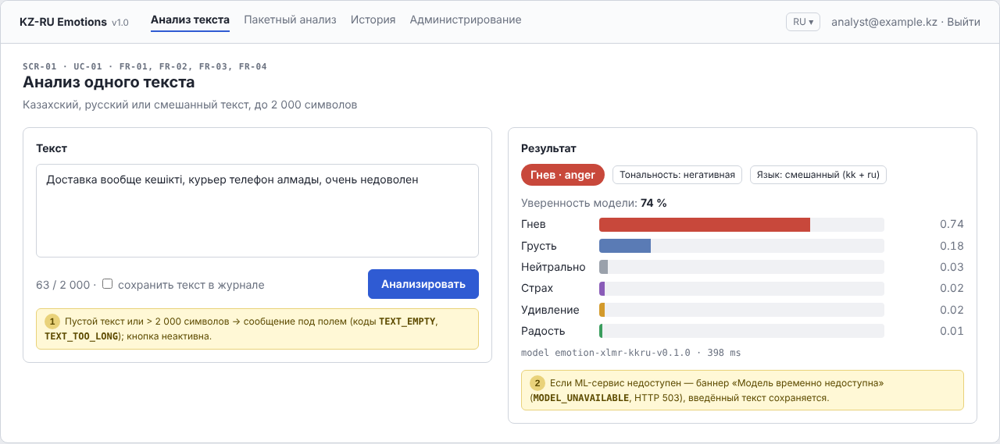
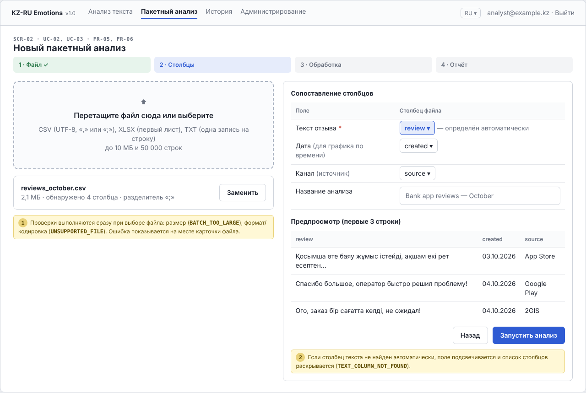
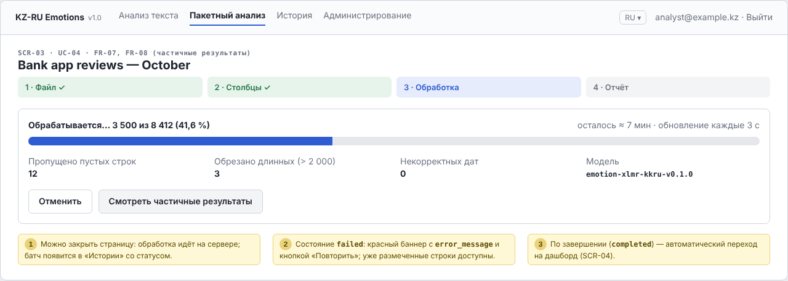
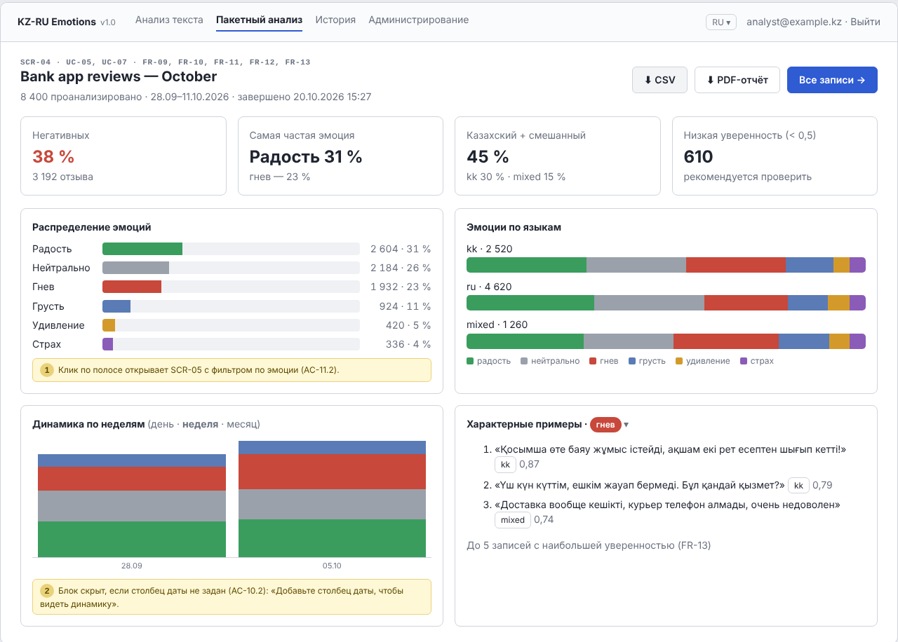
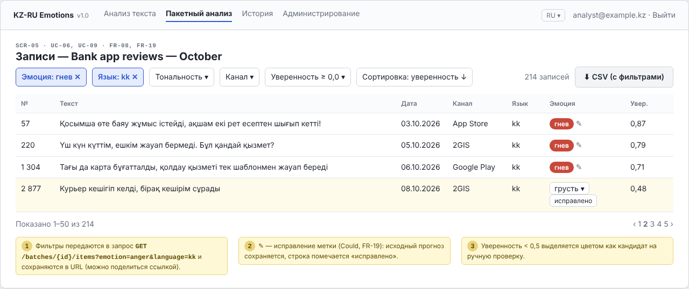
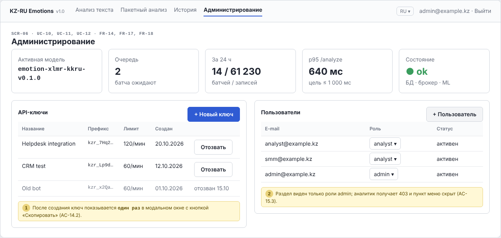

# 8. UX / Prototype and API Contracts

**Document ID:** DOC-08 · **Version:** 1.0 (draft for pre-defense-1) · **Date:** 20.10.2026
**YouTrack:** DIP-12 (UX), DIP-13 (API contract) · **Owner:** Ulan Orazbek (lead), Nurgaly Ashkenov (ML response fields) · **Reviewer:** K. Tanyrbergenova
**Related:** DOC-06 (FR, AC), DOC-07 (use cases UC-xx, components), DOC-09 (usability test TC-USE-01)
**Artefacts:** wireframes [`docs/mockups/`](mockups/) (source [`mockups/src/wireframes.html`](mockups/src/wireframes.html)) · API contract [`docs/api/openapi.yaml`](api/openapi.yaml)

---

## 8.1 Purpose

This document shows **how people and external systems interact with the platform** before it is built:

- **Humans** use six key screens (SCR-01 … SCR-06) covering the main user journeys;
- **Machines** use the REST API `/api/v1`, specified in OpenAPI 3.1 with exact JSON requests and responses.

Both are derived from the use cases in DOC-07 §7.4 and the acceptance criteria in DOC-06. Every screen and endpoint is labelled with the requirement IDs it implements.

## 8.2 Users, goals and design principles

| Persona | Goal | Typical session |
|---|---|---|
| **P1 — Aigerim, support team lead** (primary, from INT-01 profile) | Find out every Monday what made customers angry last week and pass examples to the product team | Exports last week's reviews from helpdesk → uploads CSV → opens dashboard → filters *anger + kk* → downloads CSV for the team |
| **P2 — Daniyar, SMM analyst** | Track the emotional reaction to a campaign across channels | Uploads comments with a `channel` column → compares emotions by channel and by day |
| **P3 — Integrator (helpdesk developer)** | Tag each new ticket with an emotion to route angry or frightened customers first | Calls `POST /analyze` for every new ticket from the helpdesk backend |

*Personas are provisional and will be adjusted after interviews INT-01…INT-05 (DOC-02).*

| Principle | Applied as |
|---|---|
| **Upload-to-insight in minutes** | A four-step wizard: File → Columns → Processing → Report; the dashboard opens automatically when processing finishes |
| **Every chart leads to texts** | Clicking a chart segment opens the filtered table (AC-11.2); analysts trust numbers only when they can read examples |
| **Language is a first-class dimension** | `kk / ru / mixed` appears as a KPI, a chart axis and a table filter, reflecting the project's core problem |
| **Show uncertainty honestly** | Confidence is shown for each prediction; items with confidence < 0.5 are highlighted as "needs review" |
| **Bilingual UI, trilingual data** | UI in Russian and English (NFR-14); all data views render Kazakh letters ә ғ қ ң ө ұ ү һ і correctly; Kazakh UI is Could |
| **Errors explain what to do** | Every API error code maps to a specific message and recovery action on screen (§8.6) |

## 8.3 Information architecture and navigation

```text
Login (UC-00)
└── Main navigation
    ├── Анализ текста / Text analysis ............ SCR-01  (UC-01)
    ├── Пакетный анализ / Batch analysis
    │   ├── Step 1–2: Upload & map columns ....... SCR-02  (UC-02, UC-03)
    │   ├── Step 3: Processing ................... SCR-03  (UC-04)
    │   └── Step 4: Report
    │       ├── Dashboard ........................ SCR-04  (UC-05, UC-07)
    │       └── Records table .................... SCR-05  (UC-06, UC-09)
    ├── История / History (list of batches) ....... reuses SCR-05 table layout (UC-08)
    └── Администрирование / Admin (role admin) .... SCR-06  (UC-10, UC-11, UC-12)
```

### 8.3.1 Main user flow (P1 — weekly review of angry feedback)

```text
[SCR-02] drop reviews_october.csv
   │  client-side + server checks: size ≤ 10 MB, type, encoding, header
   ▼
[SCR-02] text column auto-detected ("review"); user maps "created" → date, "source" → channel
   │  POST /batches  →  202 { id, status: queued }
   ▼
[SCR-03] progress bar, polling GET /batches/{id} every 3 s
   │  status: queued → processing → completed
   ▼
[SCR-04] dashboard: KPIs, emotion distribution, emotion × language, weekly trend, examples
   │  click "Гнев" bar
   ▼
[SCR-05] table filtered emotion=anger, add filter language=kk → 214 records
   │  "CSV (с фильтрами)"
   ▼
reviews_october_emotions.csv  (UTF-8 BOM, opens in Excel with Kazakh letters intact)
```

Target for usability test TC-USE-01 (AC-11.4): this flow is completed without help in ≤ 5 minutes.

## 8.4 Screen specifications

Wireframes are low-fidelity: layout, content and behaviour are binding; colours and typography are not. Numbered yellow notes on each wireframe describe behaviour and error states.

### SCR-01 — Single-text analysis (UC-01; FR-01–FR-04)



| Element | Behaviour | Requirement |
|---|---|---|
| Text area with counter `n / 2 000` | Button disabled for empty / whitespace text or > 2,000 characters; inline message | AC-04.1, AC-04.2 |
| "Save text in log" checkbox | Off by default; sends `store: true` | AC-01.5, NFR-09 |
| Result: emotion chip, polarity, language | From `emotion`, `polarity`, `language` of the response | FR-01–FR-03 |
| Six probability bars, sorted descending | From `probabilities`; confidence = largest bar | AC-03.1, AC-03.2 |
| Model version and processing time | From `model_version`, `processing_ms` | AC-01.2 |
| Error banner | `MODEL_UNAVAILABLE` → "Модель временно недоступна, повторите позже"; text is kept | AC-04.5 |

### SCR-02 — Batch upload and column mapping (UC-02, UC-03; FR-05, FR-06)



| Element | Behaviour | Requirement |
|---|---|---|
| Wizard steps 1–4 | Shows position in the flow; completed steps are green | — |
| Drop zone | Accepts `.csv`, `.xlsx`, `.txt`; states limits (10 MB, 50,000 rows) | AC-05.1, AC-05.2 |
| File card | Name, size, detected columns, detected delimiter; "Replace" | AC-05.1 |
| Column mapping | Text column required and auto-detected from `text`, `review`, `comment`, `отзыв`, `пікір`; date and channel optional | AC-06.1, AC-06.2 |
| Preview of first 3 rows | Lets the user check encoding and column choice before processing | AC-05.3 |
| "Start analysis" | `POST /batches` (multipart) → SCR-03 | FR-05 |

### SCR-03 — Processing (UC-04; FR-07)



| Element | Behaviour | Requirement |
|---|---|---|
| Progress bar and counters | `processed_count / total_count`; refreshed every 3 s | AC-07.1, AC-07.5 |
| Skipped / truncated / invalid dates | From `skipped_count`, `truncated_count`, `invalid_date_count` | AC-05.4, AC-06.3 |
| "Partial results" | Opens SCR-05 with items already predicted | FR-08 |
| "Cancel" (Could) | `POST /batches/{id}/cancel` | DOC-07 §7.7 |
| Failed state | Red banner with `error_message`, "Retry"; stored results remain readable | AC-07.4 |
| Completed | Auto-navigate to SCR-04 | — |

### SCR-04 — Dashboard (UC-05, UC-07; FR-09–FR-13)



All values on the wireframe are taken from the `GET /batches/{id}/stats` example in `openapi.yaml`, so the mock-up and the contract describe the same batch.

| Widget | Data source (`BatchStats`) | Requirement |
|---|---|---|
| KPI: share negative | `by_polarity.negative` | FR-09 |
| KPI: most frequent emotion | max of `by_emotion` | FR-09 |
| KPI: Kazakh + mixed share | `by_language.kk + by_language.mixed` | FR-09, H1 |
| KPI: low confidence | `low_confidence_count` | NFR-17 (transparency) |
| Emotion distribution (horizontal bars) | `by_emotion`; click → SCR-05 filtered | AC-11.1, AC-11.2 |
| Emotions by language (100 % stacked bars) | `emotion_by_language` | AC-11.1 |
| Trend (stacked columns, day / week / month) | `timeline` (only if a date column was mapped) | FR-10, AC-10.2 |
| Typical examples, emotion selector | `top_examples` | FR-13 |
| CSV / PDF buttons | `GET /export?format=csv|pdf` | FR-12 |

### SCR-05 — Records table (UC-06, UC-09; FR-08, FR-19)



| Element | Behaviour | Requirement |
|---|---|---|
| Filter chips | emotion, language, polarity, channel, min confidence → query parameters; reflected in URL | AC-08.2 |
| Sort | By row number, confidence or date | AC-08.2 |
| Table | Row, text, date, channel, language, emotion, confidence; low confidence highlighted | AC-08.1 |
| Edit label ✎ (Could) | `PUT /items/{id}/label`; row marked "исправлено", original prediction kept | FR-19 |
| Pagination | 50 per page by default, max 200 | AC-08.2 |
| "CSV (with filters)" | Exports exactly the filtered set | FR-12 |

### SCR-06 — Administration (UC-10–UC-12; FR-14, FR-17, FR-18)



| Element | Behaviour | Requirement |
|---|---|---|
| Status tiles | `GET /admin/status`, `GET /health` | AC-17.2, AC-18.1 |
| API keys table | Name, prefix only, rate limit, created / revoked | AC-14.2 |
| "New key" | Modal shows the secret **once** with "Copy"; afterwards only the prefix | AC-14.2 |
| "Revoke" | Confirm dialog → `DELETE /admin/api-keys/{id}` | AC-14.3 |
| Users table | Role selector, deactivate | FR-17 |
| Access | Menu item hidden for analysts; direct URL returns 403 page | AC-15.3 |

## 8.5 REST API

### 8.5.1 Conventions

| Topic | Convention |
|---|---|
| Base URL | `https://<host>/api/v1` — version in the path; breaking changes only in `/api/v2` |
| Format | JSON, UTF-8; `snake_case` field names; timestamps in ISO-8601 UTC |
| Authentication | `X-API-Key: <key>` for integrators; session cookie for Web UI (FR-14, FR-15) |
| Identifiers | UUID for batches, users, keys; 64-bit integers for items |
| Pagination | `page` (from 1), `page_size` (1–200, default 50); response has `page`, `page_size`, `total` |
| Long operations | `202 Accepted` + `Location` header + polling of the resource (no open HTTP connection) |
| Errors | One envelope `{ "error": { code, message, details, request_id } }`; machine-readable `code`, human `message` in `Accept-Language` (ru/en) |
| Rate limiting | Per key; `X-RateLimit-Remaining` on success, `429` + `Retry-After` when exceeded |
| Tracing | `X-Request-ID` in every response and log line |
| Contract | `docs/api/openapi.yaml` is the single source of truth; during implementation it is generated from FastAPI and CI fails on drift (NFR-11) |

### 8.5.2 Endpoint overview

| Method | Path | Purpose | Auth | Requirements |
|---|---|---|---|---|
| POST | `/analyze` | Analyse one text | key / session | FR-01–FR-04 |
| POST | `/batches` | Upload file, start batch | key / session | FR-05, FR-06 |
| GET | `/batches` | List own batches | key / session | FR-16 |
| GET | `/batches/{batch_id}` | Status and progress | key / session | FR-07 |
| DELETE | `/batches/{batch_id}` | Delete batch and all data | key / session | FR-16 |
| POST | `/batches/{batch_id}/cancel` | Cancel (Could) | key / session | DOC-07 §7.7 |
| GET | `/batches/{batch_id}/items` | Filtered, paginated results | key / session | FR-08 |
| GET | `/batches/{batch_id}/stats` | Aggregated statistics | key / session | FR-09, FR-10, FR-13 |
| GET | `/batches/{batch_id}/export` | CSV / PDF download | key / session | FR-12 |
| PUT | `/items/{item_id}/label` | Correct a label (Could) | session | FR-19 |
| POST | `/auth/login`, `/auth/logout`; GET `/auth/me` | Web session | — / session | FR-15 |
| GET, POST | `/admin/api-keys`; DELETE `/admin/api-keys/{key_id}` | API key management | admin | FR-14, FR-17 |
| GET, POST | `/admin/users`; PATCH `/admin/users/{user_id}` | User management | admin | FR-17 |
| GET | `/admin/status` | Operational status | admin | FR-17 |
| GET | `/health` | Liveness and dependencies | none | FR-18 |
| GET | `/model` | Active model and metrics | key / session | FR-18 |

22 operations in total. The contract was checked with a validation script (`scripts/check_openapi.py`, DIP-13): all `$ref`s resolve, `operationId`s are unique, path parameters are declared, and **every JSON example validates against its schema**. The script also checks domain rules: probabilities sum to 1, `emotion` = arg-max, `confidence` = max probability, polarity follows the FR-03 mapping, and statistics counts and percentages are internally consistent.

### 8.5.3 Example 1 — single-text analysis (synchronous)

**Request**

```http
POST /api/v1/analyze HTTP/1.1
Host: emotions.example.kz
X-API-Key: kzr_7Hq2xV9pL4mN8sT1wB6yR3cF0dG5jK2
Content-Type: application/json
Accept-Language: ru

{
  "text": "Доставка вообще кешікті, курьер телефон алмады, очень недоволен",
  "store": false
}
```

**Response `200 OK`**

```json
{
  "request_id": "req_01JB7Q4A2Z8N5C",
  "text_length": 63,
  "language": "mixed",
  "emotion": "anger",
  "polarity": "negative",
  "confidence": 0.74,
  "probabilities": {
    "joy": 0.01, "sadness": 0.18, "anger": 0.74,
    "fear": 0.02, "surprise": 0.02, "neutral": 0.03
  },
  "truncated": false,
  "model_version": "emotion-xlmr-kkru-v0.1.0",
  "processing_ms": 398
}
```

**Error `422` (empty text)**

```json
{
  "error": {
    "code": "TEXT_EMPTY",
    "message": "Text must not be empty",
    "details": { "field": "text" },
    "request_id": "req_01JB7R0N"
  }
}
```

*All probability values in the examples are illustrative; the real model has not been trained yet.*

### 8.5.4 Example 2 — batch processing (asynchronous)

**Step 1. Upload**

```http
POST /api/v1/batches HTTP/1.1
X-API-Key: kzr_7Hq2xV9pL4mN8sT1wB6yR3cF0dG5jK2
Content-Type: multipart/form-data; boundary=----b

------b
Content-Disposition: form-data; name="file"; filename="reviews_october.csv"
Content-Type: text/csv

review;created;source
"Қосымша өте баяу жұмыс істейді, ақшам екі рет есептен шығып кетті!";03.10.2026;App Store
"Спасибо большое, оператор быстро решил проблему!";04.10.2026;Google Play
...
------b
Content-Disposition: form-data; name="name"

Bank app reviews — October
------b
Content-Disposition: form-data; name="text_column"

review
------b
Content-Disposition: form-data; name="date_column"

created
------b
Content-Disposition: form-data; name="channel_column"

source
------b--
```

**Response `202 Accepted`** (header `Location: /api/v1/batches/7f3c2a9e-…`)

```json
{
  "id": "7f3c2a9e-5b1d-4c8e-9a6f-2d4b8e1c0a57",
  "name": "Bank app reviews — October",
  "original_filename": "reviews_october.csv",
  "file_format": "csv",
  "status": "queued",
  "progress": 0,
  "total_count": 0,
  "processed_count": 0,
  "skipped_count": 0,
  "truncated_count": 0,
  "invalid_date_count": 0,
  "column_map": { "text_column": "review", "date_column": "created", "channel_column": "source" },
  "model_version": "emotion-xlmr-kkru-v0.1.0",
  "error_message": null,
  "created_at": "2026-10-20T10:15:02Z",
  "started_at": null,
  "finished_at": null,
  "expires_at": "2026-11-19T10:15:02Z",
  "links": {
    "self":   "/api/v1/batches/7f3c2a9e-5b1d-4c8e-9a6f-2d4b8e1c0a57",
    "items":  "/api/v1/batches/7f3c2a9e-5b1d-4c8e-9a6f-2d4b8e1c0a57/items",
    "stats":  "/api/v1/batches/7f3c2a9e-5b1d-4c8e-9a6f-2d4b8e1c0a57/stats",
    "export": "/api/v1/batches/7f3c2a9e-5b1d-4c8e-9a6f-2d4b8e1c0a57/export?format=csv"
  }
}
```

**Step 2. Poll status** — `GET /api/v1/batches/7f3c2a9e-…` returns the same object with `"status": "processing"`, `"progress": 41.6`, `"total_count": 8412`, `"processed_count": 3500`, … until `"status": "completed"`.

**Step 3. Statistics** — `GET /api/v1/batches/7f3c2a9e-…/stats?granularity=week` → `200 OK` (shortened):

```json
{
  "batch_id": "7f3c2a9e-5b1d-4c8e-9a6f-2d4b8e1c0a57",
  "analysed_count": 8400,
  "by_emotion": {
    "joy": { "count": 2604, "percent": 31.0 }, "sadness": { "count": 924, "percent": 11.0 },
    "anger": { "count": 1932, "percent": 23.0 }, "fear": { "count": 336, "percent": 4.0 },
    "surprise": { "count": 420, "percent": 5.0 }, "neutral": { "count": 2184, "percent": 26.0 }
  },
  "by_polarity": {
    "positive": { "count": 2604, "percent": 31.0 },
    "negative": { "count": 3192, "percent": 38.0 },
    "neutral":  { "count": 2604, "percent": 31.0 }
  },
  "by_language": {
    "kk": { "count": 2520, "percent": 30.0 },
    "ru": { "count": 4620, "percent": 55.0 },
    "mixed": { "count": 1260, "percent": 15.0 }
  },
  "emotion_by_language": {
    "kk":    { "joy": 756,  "sadness": 302, "anger": 630, "fear": 101, "surprise": 101, "neutral": 630 },
    "ru":    { "joy": 1478, "sadness": 462, "anger": 970, "fear": 185, "surprise": 254, "neutral": 1271 },
    "mixed": { "joy": 370,  "sadness": 160, "anger": 332, "fear": 50,  "surprise": 65,  "neutral": 283 }
  },
  "mean_confidence": 0.78,
  "low_confidence_count": 610,
  "timeline": { "granularity": "week", "points": [ { "period_start": "2026-09-28", "counts": { "joy": 610, "...": "..." } } ] },
  "top_examples": {
    "anger": [ { "item_id": 1048, "text": "Қосымша өте баяу жұмыс істейді, ақшам екі рет есептен шығып кетті!", "language": "kk", "confidence": 0.87 } ]
  },
  "computed_at": "2026-10-20T10:27:40Z"
}
```

**Step 4. Filtered records** — `GET /api/v1/batches/7f3c2a9e-…/items?emotion=anger&language=kk&page=1&page_size=2`:

```json
{
  "page": 1, "page_size": 2, "total": 214,
  "items": [
    {
      "id": 1048, "row_number": 57,
      "text": "Қосымша өте баяу жұмыс істейді, ақшам екі рет есептен шығып кетті!",
      "item_date": "2026-10-03T00:00:00Z", "channel": "App Store",
      "language": "kk", "emotion": "anger", "polarity": "negative", "confidence": 0.87,
      "probabilities": { "joy": 0.01, "sadness": 0.06, "anger": 0.87, "fear": 0.03, "surprise": 0.01, "neutral": 0.02 },
      "truncated": false, "corrected_emotion": null
    }
  ]
}
```

**Step 5. Export** — `GET /api/v1/batches/7f3c2a9e-…/export?format=csv` → `text/csv` (UTF-8 with BOM):

```text
review,created,source,emotion,polarity,language,confidence
"Қосымша өте баяу жұмыс істейді, ақшам екі рет есептен шығып кетті!",2026-10-03,App Store,anger,negative,kk,0.87
"Спасибо большое, оператор быстро решил проблему!",2026-10-04,Google Play,joy,positive,ru,0.93
```

### 8.5.5 Integration example for P3 (helpdesk)

```python
import httpx

API = "https://emotions.example.kz/api/v1"
HEADERS = {"X-API-Key": "<key from administrator>"}

def tag_ticket(text: str) -> dict:
    r = httpx.post(f"{API}/analyze", json={"text": text}, headers=HEADERS, timeout=10)
    if r.status_code == 429:                       # rate limit — retry later
        raise RuntimeError(f"retry after {r.headers['Retry-After']} s")
    r.raise_for_status()
    result = r.json()
    priority = "high" if result["emotion"] in ("anger", "fear") and result["confidence"] >= 0.6 else "normal"
    return {"emotion": result["emotion"], "language": result["language"], "priority": priority}
```

## 8.6 Error catalogue (API ↔ UI)

| HTTP | `code` | When | UI message (ru) / action |
|---|---|---|---|
| 401 | `UNAUTHORIZED` | Missing / invalid key or session | Redirect to login |
| 403 | `FORBIDDEN` | Analyst opens admin function | "Недостаточно прав" page |
| 404 | `NOT_FOUND` | Unknown batch or someone else's batch | "Анализ не найден" + link to History |
| 409 | `BATCH_NOT_COMPLETED` | Stats / export requested while processing | Stay on SCR-03 |
| 409 | `INVALID_STATE_TRANSITION` | e.g., cancel a completed batch | Toast with the reason |
| 413 | `BATCH_TOO_LARGE` | > 10 MB or > 50,000 rows | Under drop zone: "Файл больше 10 МБ — разделите его на части" |
| 415 | `UNSUPPORTED_FILE` | Wrong extension / encoding | "Поддерживаются CSV, XLSX, TXT в UTF-8" |
| 422 | `TEXT_EMPTY`, `TEXT_TOO_LONG` | Single-text validation | Inline under the text area |
| 422 | `TEXT_COLUMN_NOT_FOUND` | Column mapping failed | Highlight mapping field, list columns |
| 422 | `VALIDATION_ERROR` | Other invalid parameters | Inline field message |
| 429 | `RATE_LIMITED` | Rate limit exceeded | "Слишком много запросов, повторите через N с" |
| 503 | `MODEL_UNAVAILABLE` | ML service down / timeout | Banner; input kept; batch continues retrying |
| 500 | `INTERNAL_ERROR` | Unexpected | Generic message with `request_id` for support |

## 8.7 Accessibility and localisation

- Emotion colours are always accompanied by text labels, so charts remain readable for colour-blind users and in grayscale print.
- Keyboard navigation for the wizard and the table; visible focus states; minimum contrast 4.5:1 for text (WCAG 2.1 AA as a target, not a formal certification).
- Number and date formats follow the UI language (`8 400` and `20.10.2026` in ru, `8,400` and `2026-10-20` in en).
- Fonts with full Kazakh Cyrillic coverage are used in UI and PDF reports (NFR-14), verified by a visual test with the string `ә ғ қ ң ө ұ ү һ і Ә Ғ Қ Ң Ө Ұ Ү Һ І`.

## 8.8 Validation plan for the prototype

| Step | When | Who | Output |
|---|---|---|---|
| Walk-through of SCR-01…SCR-06 with the supervisor | Before 24.10.2026 | Team + supervisor | Comments in DOC-11 |
| Show wireframes during interviews (question 7 of the guide) | INT-01…INT-05 | Interviewers | Feedback per screen in interview notes |
| Clickable prototype (HTML or Figma) | Nov 2026 | Ulan | Updated wireframes v2 |
| Usability test on the working UI (TC-USE-01) | Apr 2027 | ≥ 3 target users | Task success, time, SUS score (NFR-13) |
