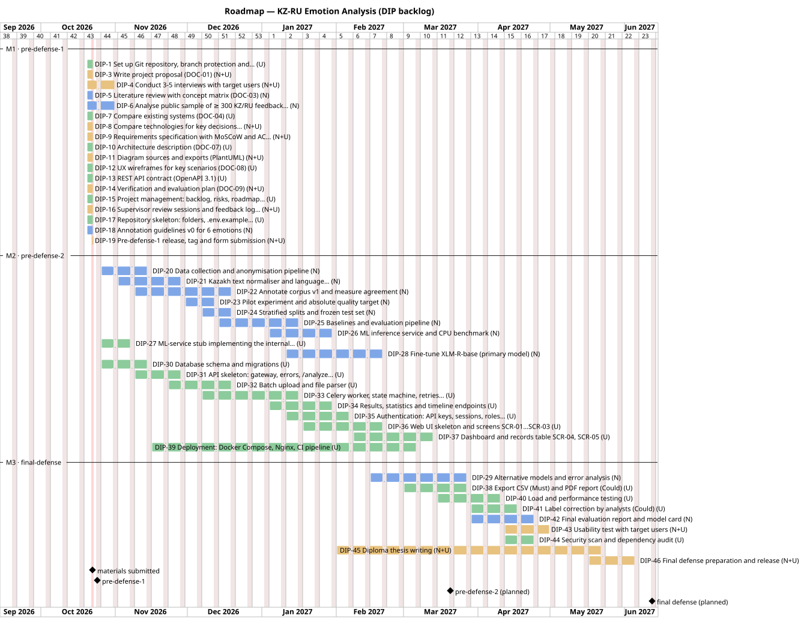

# 10. Project Management and Risks

**Document ID:** DOC-10 · **Version:** 1.0 (draft for pre-defense-1) · **Date:** 20.10.2026
**YouTrack:** DIP-15 · **Owner:** Ulan Orazbek (lead), Nurgaly Ashkenov · **Reviewer:** K. Tanyrbergenova
**Generated artefacts:** [`docs/pm/backlog.csv`](pm/backlog.csv) (YouTrack import) · [`docs/diagrams/src/11-roadmap.puml`](diagrams/src/11-roadmap.puml) — both produced by [`scripts/backlog.py`](../scripts/backlog.py), the single source of truth for tasks

---

## 10.1 Purpose

This document makes the project **traceable and predictable**: who does what, by when, in which order, how every change is linked to a requirement, and what could go wrong. It is updated at every milestone; the version history is at the end.

## 10.2 Team and responsibilities

### 10.2.1 Roles

| Member | Role | Owns (accountable) | Contributes to |
|---|---|---|---|
| **Nurgaly Ashkenov** | ML/NLP Engineer | Data collection and annotation, preprocessing and language ID, model training and evaluation, ML inference service, model card | Requirements (MLR), verification plan (§9.4), thesis ML chapters, second reviewer of backend PRs |
| **Ulan Orazbek** | Backend Developer & System Integrator | Architecture, REST API, batch worker, PostgreSQL, Web UI, Docker, CI, load and security tests, project management | Second annotator (κ subset), thesis system chapters, second reviewer of ML PRs |
| **Kamila Tanyrbergenova** | Scientific supervisor | Approval of scope, key decisions and milestone packages | Reviews of artefacts (logged in DOC-11) |

### 10.2.2 RACI for key deliverables

R = responsible (does the work), A = accountable (final decision inside the team), C = consulted, I = informed.

| Deliverable | Nurgaly | Ulan | Supervisor |
|---|---|---|---|
| DOC-01 Proposal, DOC-02 Evidence | R | A/R | C |
| DOC-03 Literature review | A/R | C | C |
| DOC-04 Existing systems, DOC-05 Technologies | R (TD-4) | A/R | C |
| DOC-06 Requirements, DOC-07 Architecture | R (MLR, ML service) | A/R | C |
| DOC-08 UX & API | C | A/R | I |
| DOC-09 Verification plan | A/R (§9.4) | R (§9.3, §9.5–9.7) | C |
| DOC-10 PM, DOC-11 Feedback log | R | A/R | I |
| Annotated corpus, trained model, evaluation report | A/R | R (2nd annotator) | C |
| Backend, worker, Web UI, deployment | C | A/R | I |
| Thesis | A/R (ML chapters) | A/R (system chapters) | A (approval) |

## 10.3 Working process

### 10.3.1 Cadence

| Event | When | Participants | Output |
|---|---|---|---|
| Weekly sync | Monday, 30 min | Nurgaly, Ulan | YouTrack board updated; blockers recorded as issues |
| Two-week iteration | Sprints of 2 weeks, starting Mon 26.10.2026 | Team | Sprint = YouTrack sprint on the agile board |
| Supervisor review | Every 2 weeks, and before each milestone | Team + supervisor | Entry in DOC-11 (SFB-xx) with decisions |
| Milestone review | Pre-defense-1, pre-defense-2, final | Team + committee | Tag in Git, test report, updated documents |

### 10.3.2 YouTrack configuration

| Setting | Value |
|---|---|
| Project | `KZ-RU Emotion Analysis`, key **`DIP`** |
| Issue types | Task, Feature, Research, Docs, Design, Test, Bug, Requirement Change |
| States | To Do → In Progress → In Review → Done (+ Blocked) |
| Custom fields | Assignee, Priority (Critical / High / Medium / Low), Fix version (= milestone: `pre-defense-1`, `pre-defense-2`, `final-defense`), Start date, Due date, Requirements (text: FR/NFR/MLR IDs) |
| Links | *depends on / is required for* between issues (§10.7); *relates to* for bugs ↔ features |
| Board | Agile board by State, swimlanes by Assignee, filtered by current sprint |
| VCS integration | GitHub repository connected, so commits and PRs that mention `DIP-xx` appear in the issue's activity stream |
| Import | `docs/pm/backlog.csv` contains all 46 issues with every field; it can be imported (YouTrack CSV import, where available in the instance) or used as the checklist for manual creation |

### 10.3.3 Definition of Ready and Definition of Done

| Definition of Ready (task may start) | Definition of Done (task may be closed) |
|---|---|
| Expected result and acceptance criteria written | All acceptance criteria met and checked by the other team member |
| Owner and due date set | Code / document merged into `develop` through a PR with ≥ 1 approval |
| Dependencies are Done or explicitly mocked (e.g., DIP-27 stub) | CI green (lint, tests, coverage ≥ 70 % for code, OpenAPI drift check) |
| Linked to at least one requirement or document section | Requirement and test IDs referenced in the PR description |
| | Documentation updated (README, DOC-xx, diagrams) where affected |

## 10.4 Roadmap and milestones



*Colours: blue — Nurgaly, green — Ulan, orange — both. Generated from `scripts/backlog.py`.*

| Milestone | Date | Scope | Exit evidence | Git tag |
|---|---|---|---|---|
| **M1 pre-defense-1** | Materials submitted 22.10.2026; pre-defense 24.10.2026 | Analysis and design: 11 artefacts, repository skeleton, backlog | DOC-01…DOC-11 v1.0; supervisor review logged; CI green; ≥ 3 interviews (**not met at submission — moved to 31.10, DIP-4**) | `prob-period-1` + `pre-defense-1` (same commit) |
| M1.5 Data & contracts | 20.12.2026 | Annotated corpus v1, splits, DB schema, API skeleton, batch upload | κ report; frozen test set hash; TC-INT-01…04 pass against stub | — (internal) |
| **M2 pre-defense-2** | ≈ 20.03.2027 *(date set by department)* | MVP: fine-tuned model, single + batch API, dashboard, Docker deployment | Baseline + XLM-R results per slice; Must API tests pass; TC-E2E-01; first load test | `pre-defense-2` |
| M2.5 Evaluation & hardening | 30.04.2027 | Alternatives, error analysis, load, security, usability tests | Final evaluation report, model card, test report | — |
| **M3 final-defense** | ≈ 12.06.2027 *(date set by department)* | Complete system, thesis | Thesis approved; demo on clean deployment | `final-defense` |

## 10.5 Git workflow and traceability chain

### 10.5.1 Traceability chain

```text
Evidence (DOC-02: H1, INT-03)            why the requirement exists
   └─► Requirement (DOC-06: FR-05, AC-05.2)    what must be true
         └─► Design (DOC-07: Batch Service; DOC-08: POST /batches, SCR-02)
               └─► YouTrack issue DIP-32 (owner, due date, AC)
                     └─► Branch DIP-32-batch-upload-endpoint
                           └─► Commits "DIP-32: …"  ──► PR "DIP-32: …" (review + CI)
                                 └─► Tests TC-INT-03, TC-INT-04 (DOC-09) ──► test report
                                       └─► Tag pre-defense-2 / final-defense
```

Any element can be followed in both directions: from a commit to the requirement it serves (through the issue ID), or from a requirement to the commits that implement it (YouTrack issue activity).

### 10.5.2 Conventions (summary of README §6)

| Item | Rule | Example |
|---|---|---|
| Branches | From `develop`, named `DIP-<n>-<kebab-summary>` | `DIP-21-kazakh-text-normalizer` |
| Commit message | `DIP-<n>: <imperative summary>`, ≤ 72 chars; body explains *why* | `DIP-33: add idempotent prediction upsert and chunk retries` |
| Pull request | Title = `DIP-<n>: <summary>`; template asks for requirement IDs, test IDs, screenshots; ≥ 1 approval from the other member | — |
| Merge | Squash-merge feature → `develop`; `develop` → `main` only at milestones via PR | — |
| Tags | Annotated tags on `main` at milestones; never moved once pushed. For the first submission two tags mark the same commit: `prob-period-1` (submission form) and `pre-defense-1` (repository requirements) | `git tag -a prob-period-1 -m "Probationary period 1"` |
| Authorship | Each member commits **their own** work from their own account, so the history reflects real contribution | — |

### 10.5.3 Pull request template (`.github/PULL_REQUEST_TEMPLATE.md`)

```markdown
## DIP-__ : <summary>

**YouTrack:** DIP-__
**Requirements:** FR-__ / NFR-__ / MLR-__   **Tests:** TC-___
**Type:** feature | fix | docs | test | refactor

### What and why
-

### How it was verified
- [ ] Unit tests added/updated
- [ ] Integration tests pass locally
- [ ] Docs / diagrams / openapi.yaml updated if affected

### Screenshots / output (if UI or report)
```

## 10.6 Backlog (YouTrack issues)

All 46 issues are listed below with owner, due date, state at submission (22.10.2026), dependencies, expected result, acceptance criteria and example branch / commit. States reflect the actual situation of the team and must be updated in YouTrack, not in this file; the file is regenerated from `scripts/backlog.py` at milestones.

#### M1 — pre-defense-1 (analysis & design; materials submitted 22.10.2026, pre-defense 24.10.2026)

| ID | Task | Owner | Due | State | Depends on | Expected result | Acceptance criteria | Branch / commit example |
|---|---|---|---|---|---|---|---|---|
| **DIP-1** | Set up Git repository, branch protection and YouTrack project (README) | Ulan | 22.10.2026 | Done | — | GitHub repo with main/develop, protected main, YouTrack project DIP with issue types, states and VCS integration | main protected (PR + 1 review); develop exists; YouTrack shows commits linked to DIP issues; both members have access | `DIP-1-repo-setup`<br>`DIP-1: add initial README, .gitignore and folder skeleton` |
| **DIP-2** | Agree topic, scope and role split with supervisor (DOC-01 §1.2) | Both | 01.10.2026 | Done | — | Approved topic in EN/RU/KZ, roles of Nurgaly and Ulan fixed | Topic and roles confirmed by supervisor (entry SFB-00 in DOC-11) | — |
| **DIP-3** | Write project proposal (DOC-01) (O1–O10) | Both | 22.10.2026 | Done | DIP-2 | docs/01-project-proposal.md v1.0 | All proposal sections present; scope In/Out explicit; reviewed by supervisor; comments resolved in DOC-11 | `DIP-3-project-proposal`<br>`DIP-3: add project proposal draft v1` |
| **DIP-4** | Conduct 3–5 interviews with target users (DOC-02 H1–H7) | Both | 31.10.2026 | In Progress | DIP-3 | Anonymised notes INT-01…INT-05 in docs/evidence/interviews/, hypotheses H1–H7 updated in DOC-02 | ≥ 3 interviews recorded with consent; each note uses the template; DOC-02 §2.7 moves at least H1, H2, H5 to Verified or Refuted | `DIP-4-user-interviews`<br>`DIP-4: add anonymised notes INT-01 (support team lead)` |
| **DIP-5** | Literature review with concept matrix (DOC-03) (O2) | Nurgaly | 22.10.2026 | Done | — | docs/03-literature-review.md, docs/literature/references.bib | ≥ 12 sources, ≥ 8 scientific; every DOI verified; concept matrix and analytical table complete; BRIGHTER language list re-checked | `DIP-5-literature-review`<br>`DIP-5: add concept matrix and analytical summary table` |
| **DIP-6** | Analyse public sample of ≥ 300 KZ/RU feedback texts (DOC-02 §2.4, H1, H7) | Nurgaly | 31.10.2026 | In Progress | DIP-18 | Filled results table in DOC-02 §2.4; analysis notebook in docs/evidence/data-analysis/ | ≥ 300 texts from ≥ 3 sources; shares of kk/ru/mixed and informal reported; κ on double-labelled subset; no personal data committed | `DIP-6-public-data-analysis`<br>`DIP-6: add language-mix analysis of 300 public reviews` |
| **DIP-7** | Compare existing systems (DOC-04) (C1–C10) | Ulan | 22.10.2026 | Done | DIP-5 | docs/04-existing-systems.md | ≥ 3 systems × 6–10 criteria; every claim backed by a source with check date | `DIP-7-existing-systems`<br>`DIP-7: add comparison matrix of 7 existing systems` |
| **DIP-8** | Compare technologies for key decisions (DOC-05) (TD-1…TD-5) | Both | 22.10.2026 | Done | — | docs/05-technology-comparison.md | ≥ 3 decisions × 2–3 alternatives; weighted matrix with drivers; decision log; both members agree on scores | `DIP-8-technology-comparison`<br>`DIP-8: add weighted decision matrix for backend framework` |
| **DIP-9** | Requirements specification with MoSCoW and AC (DOC-06) (FR, NFR, MLR) | Both | 22.10.2026 | Done | DIP-3 | docs/06-requirements.md | Every Must requirement has measurable AC and a test ID; traceability matrix complete | `DIP-9-requirements-spec`<br>`DIP-9: add functional requirements with acceptance criteria` |
| **DIP-10** | Architecture description (DOC-07) (§7.13) | Ulan | 22.10.2026 | Done | DIP-9 | docs/07-architecture.md | C4 levels 1–3 described; consistency table (§7.13) has no gaps for Must requirements | `DIP-10-architecture`<br>`DIP-10: add container view and internal ML contract` |
| **DIP-11** | Diagram sources and exports (PlantUML) (D1–D10) | Both | 22.10.2026 | Done | DIP-10 | docs/diagrams/src/*.puml + export/*.svg|png | All diagrams render without errors; names match DOC-06/DOC-07; ML pipeline diagram reviewed by Nurgaly | `DIP-11-diagrams`<br>`DIP-11: add system context and use case diagrams` |
| **DIP-12** | UX wireframes for key scenarios (DOC-08) (SCR-01…06) | Ulan | 22.10.2026 | Done | DIP-9 | docs/08-ux-prototype.md, docs/mockups/*.png | 6 screens with requirement labels and error states; walkthrough with supervisor done | `DIP-12-ux-wireframes`<br>`DIP-12: add dashboard and results table wireframes` |
| **DIP-13** | REST API contract (OpenAPI 3.1) (FR-01…FR-19) | Ulan | 22.10.2026 | Done | DIP-9 | docs/api/openapi.yaml, scripts/check_openapi.py | scripts/check_openapi.py passes; JSON examples for single and batch flows | `DIP-13-openapi-contract`<br>`DIP-13: add OpenAPI contract for batch endpoints` |
| **DIP-14** | Verification and evaluation plan (DOC-09) (TC-*) | Both | 22.10.2026 | Done | DIP-9 | docs/09-verification-plan.md | Every test ID referenced in DOC-06 defined; ML metrics per slice, baselines and conditions specified | `DIP-14-verification-plan`<br>`DIP-14: add ML evaluation protocol per language slice` |
| **DIP-15** | Project management: backlog, risks, roadmap (DOC-10) (DOC-10) | Ulan | 22.10.2026 | Done | — | docs/10-project-management.md, docs/pm/backlog.csv, roadmap diagram | All DIP tasks have owner, result, AC, deadline, branch, commit; risk matrix scored; issues created in YouTrack | `DIP-15-project-management`<br>`DIP-15: add risk matrix and roadmap` |
| **DIP-16** | Supervisor review sessions and feedback log (DOC-11) (DOC-11) | Both | 22.10.2026 | Done | DIP-3 | docs/11-supervisor-feedback.md with ≥ 1 real review entry | Feedback recorded with date, artefact, comment, decision, resulting commit/issue | `DIP-16-supervisor-feedback`<br>`DIP-16: log supervisor review of requirements (SFB-01)` |
| **DIP-17** | Repository skeleton: folders, .env.example, compose stub, CI lint (NFR-10, NFR-12) | Ulan | 22.10.2026 | Done | DIP-1 | All folders from README tree with .gitkeep; .env.example; docker-compose.yml stub; GitHub Actions running ruff on PRs | README tree matches repository; CI badge green on develop | `DIP-17-repo-skeleton`<br>`DIP-17: add CI workflow with lint job` |
| **DIP-18** | Annotation guidelines v0 for 6 emotions (MLR-02) | Nurgaly | 22.10.2026 | Done | DIP-5 | ml/annotation/guidelines.md v0 with ≥ 3 examples per label per slice | Used for the DIP-6 pilot; disagreement cases listed for v1 | `DIP-18-annotation-guidelines`<br>`DIP-18: add annotation guidelines v0 with KZ/RU/mixed examples` |
| **DIP-19** | Pre-defense-1 release, tag and form submission (—) | Both | 22.10.2026 | In Progress | DIP-3, DIP-5, DIP-7, DIP-8, DIP-9, DIP-10, DIP-11, DIP-12, DIP-13, DIP-14, DIP-15, DIP-16, DIP-17, DIP-18 | GitHub release with tags prob-period-1 and pre-defense-1 on main; consolidated PDF; submission form sent; slides for 24.10 | develop merged to main via reviewed PR; release published with notes and PDF; form submitted 22.10; all links open for supervisor and committee | `DIP-19-pre-defense-1-release`<br>`DIP-19: update README status table for pre-defense-1` |

#### M2 — pre-defense-2 (data, baselines, MVP)

| ID | Task | Owner | Due | State | Depends on | Expected result | Acceptance criteria | Branch / commit example |
|---|---|---|---|---|---|---|---|---|
| **DIP-20** | Data collection and anonymisation pipeline (MLR-08) | Nurgaly | 15.11.2026 | To Do | DIP-18 | ml/src/preprocessing/collect.py, anonymise.py; ml/data/README.md with sources and licences | Unit tests remove names, phones, IIN, e-mails on fixtures; licences listed; raw data never committed | `DIP-20-data-pipeline`<br>`DIP-20: add anonymisation of phones, IIN and e-mails` |
| **DIP-21** | Kazakh text normaliser and language identifier (kk/ru/mixed) (FR-02, AC-02.1–02.4) | Nurgaly | 29.11.2026 | To Do | DIP-20 | ml/src/preprocessing/normalize.py, langid.py | TC-UNIT-05 passes; TC-ML-07 accuracy ≥ 95 % kk/ru, ≥ 85 % mixed on pilot set | `DIP-21-kazakh-text-normalizer`<br>`DIP-21: normalize Kazakh-specific Cyrillic letters before tokenization` |
| **DIP-22** | Annotate corpus v1 and measure agreement (MLR-02) | Nurgaly | 20.12.2026 | To Do | DIP-18, DIP-20 | Labelled corpus v1 (≥ 3,000 kk/mixed items) + κ report | ≥ 15 % double-annotated (Ulan second annotator); κ reported; guidelines v1 | `DIP-22-annotation-v1`<br>`DIP-22: add agreement report for annotation round 1` |
| **DIP-23** | Pilot experiment and absolute quality target (MLR-06) | Nurgaly | 13.12.2026 | To Do | DIP-21 | Pilot results on the first 1,000 items annotated in DIP-22 (partial dependency); absolute Macro-F1 target proposed | Target agreed with supervisor and logged in DOC-11; MLR-06 updated | `DIP-23-pilot-experiment`<br>`DIP-23: add pilot TF-IDF and XLM-R results` |
| **DIP-24** | Stratified splits and frozen test set (MLR-03, MLR-04) | Nurgaly | 20.12.2026 | To Do | DIP-22 | ml/src/data/split.py; test_set.sha256 | TC-ML-03 and TC-ML-04 pass; hash committed | `DIP-24-stratified-splits`<br>`DIP-24: add stratified split with near-duplicate check` |
| **DIP-25** | Baselines and evaluation pipeline (MLR-05, TC-ML-05) | Nurgaly | 17.01.2027 | To Do | DIP-24 | TF-IDF, mBERT, RuBERT-tiny2-CEDR, LLM zero-shot results; ml/src/evaluation/ | Per-slice tables and confusion matrices generated automatically; bootstrap implemented | `DIP-25-baselines-eval`<br>`DIP-25: add per-slice evaluation report generator` |
| **DIP-26** | ML inference service and CPU benchmark (FR-01–FR-03, FR-18, NFR-01) | Nurgaly | 31.01.2027 | To Do | DIP-27 | ml-service/ with /predict, /model, /health; latency benchmark | Contract identical to stub; p95 latency of 1 text measured and NFR-01 budget re-baselined in DOC-06/DOC-11 | `DIP-26-ml-inference-service`<br>`DIP-26: add /predict endpoint with batching up to 64 texts` |
| **DIP-27** | ML-service stub implementing the internal contract (DOC-07 §7.5.1) | Ulan | 08.11.2026 | To Do | DIP-13 | ml-service/stub/ Docker image with deterministic predictions | Backend integration tests run in CI against the stub | `DIP-27-ml-service-stub`<br>`DIP-27: add deterministic ML stub for integration tests` |
| **DIP-28** | Fine-tune XLM-R-base (primary model) (MLR-01, MLR-06) | Nurgaly | 21.02.2027 | To Do | DIP-25 | Model emotion-xlmr-kkru-v0.1.0 + config + report | 3 seeds; TC-ML-01 and TC-ML-06 pass on all slices | `DIP-28-xlmr-finetune`<br>`DIP-28: add XLM-R fine-tuning config and training script` |
| **DIP-30** | Database schema and migrations (O8, DOC-07 §7.8) | Ulan | 15.11.2026 | To Do | DIP-17 | SQLAlchemy models + Alembic migration 0001 | Migration up/down on clean DB; ER diagram matches code | `DIP-30-db-schema`<br>`DIP-30: add initial Alembic migration for batches and predictions` |
| **DIP-31** | API skeleton: gateway, errors, /analyze, /health, /model (FR-01, FR-04, FR-18) | Ulan | 29.11.2026 | To Do | DIP-27, DIP-30 | backend/app with routers and unified error handler | TC-UNIT-04, TC-INT-01, TC-INT-02, TC-INT-16 pass against stub; OpenAPI drift check green | `DIP-31-api-skeleton`<br>`DIP-31: add unified error envelope and /analyze endpoint` |
| **DIP-32** | Batch upload and file parser (FR-05, FR-06) | Ulan | 20.12.2026 | To Do | DIP-31 | POST /batches; File Parser for CSV/XLSX/TXT | TC-UNIT-06, TC-INT-03, TC-INT-04 pass | `DIP-32-batch-upload-endpoint`<br>`DIP-32: add POST /api/v1/batches endpoint with CSV validation` |
| **DIP-33** | Celery worker, state machine, retries, retention (FR-07, FR-16, NFR-05) | Ulan | 17.01.2027 | To Do | DIP-32 | Batch Processing Task, Scheduler | TC-UNIT-07, TC-INT-05, TC-INT-09, TC-INT-14 pass | `DIP-33-batch-worker`<br>`DIP-33: add idempotent prediction upsert and chunk retries` |
| **DIP-34** | Results, statistics and timeline endpoints (FR-08–FR-10, FR-13) | Ulan | 31.01.2027 | To Do | DIP-33 | /items, /stats with batch_stats aggregation | TC-INT-06, TC-INT-07, TC-INT-08, TC-INT-11 pass; /stats ≤ 1 s on 50k items | `DIP-34-results-stats`<br>`DIP-34: add batch_stats aggregation after completion` |
| **DIP-35** | Authentication: API keys, sessions, roles, admin (FR-14, FR-15, FR-17) | Ulan | 07.02.2027 | To Do | DIP-31 | Auth Module + admin endpoints | TC-UNIT-08, TC-INT-12, TC-INT-13, TC-INT-15 pass | `DIP-35-auth-api-keys`<br>`DIP-35: add hashed API keys with per-key rate limit` |
| **DIP-36** | Web UI skeleton and screens SCR-01…SCR-03 (FR-01, FR-05–FR-07) | Ulan | 21.02.2027 | To Do | DIP-31, DIP-32 | frontend/ React app; typed client from openapi.yaml | Single analysis and upload wizard work end-to-end against stub | `DIP-36-web-ui-upload`<br>`DIP-36: add upload wizard with column mapping` |
| **DIP-37** | Dashboard and records table SCR-04, SCR-05 (FR-11, FR-13) | Ulan | 14.03.2027 | To Do | DIP-34, DIP-36 | Dashboard with charts and filtered table | TC-E2E-01 passes; click on chart filters table (AC-11.2) | `DIP-37-dashboard`<br>`DIP-37: add emotion-by-language stacked chart` |
| **DIP-39** | Deployment: Docker Compose, Nginx, CI pipeline (NFR-07, NFR-10–NFR-12) | Ulan | 07.03.2027 | To Do | DIP-17 | docker-compose.yml, nginx.conf, full CI | TC-CI-01 passes; fresh VM start ≤ 10 min (NFR-12 checklist) | `DIP-39-deployment-ci`<br>`DIP-39: add nginx reverse proxy with TLS to compose` |

#### M3 — final-defense (full system, evaluation, thesis)

| ID | Task | Owner | Due | State | Depends on | Expected result | Acceptance criteria | Branch / commit example |
|---|---|---|---|---|---|---|---|---|
| **DIP-29** | Alternative models and error analysis (DOC-05 TD-4, DOC-09 §9.4.6) | Nurgaly | 28.03.2027 | To Do | DIP-28 | mDeBERTa-v3 (and XLM-R-large if feasible) results; error analysis of ≥ 100 items | Comparison table with CI; error causes distribution reported | `DIP-29-alt-models`<br>`DIP-29: add error analysis of misclassified mixed-language items` |
| **DIP-38** | Export CSV (Must) and PDF report (Could) (FR-12) | Ulan | 28.03.2027 | To Do | DIP-34 | Report Service | TC-INT-10 passes; PDF renders Kazakh letters | `DIP-38-export-reports`<br>`DIP-38: add CSV export with BOM and formula escaping` |
| **DIP-40** | Load and performance testing (NFR-01–NFR-05) | Ulan | 11.04.2027 | To Do | DIP-26, DIP-33, DIP-39 | Locust scenarios + load-test report | TC-LOAD-01…03 executed 3×; results and any mitigations documented | `DIP-40-load-tests`<br>`DIP-40: add Locust scenario for concurrent batches` |
| **DIP-41** | Label correction by analysts (Could) (FR-19) | Ulan | 18.04.2027 | To Do | DIP-37 | PUT /items/{id}/label + UI | TC-INT-17 passes | `DIP-41-label-correction`<br>`DIP-41: add label correction endpoint and table edit` |
| **DIP-42** | Final evaluation report and model card (MLR-05, NFR-16, NFR-17) | Nurgaly | 25.04.2027 | To Do | DIP-28, DIP-29 | ml/reports/final-evaluation.md, model card | TC-ML-05, TC-ML-08 pass; informal vs. formal gap reported | `DIP-42-final-evaluation`<br>`DIP-42: add model card with per-slice metrics` |
| **DIP-43** | Usability test with target users (AC-11.4, NFR-13) | Both | 30.04.2027 | To Do | DIP-37 | Usability report (TC-USE-01) | ≥ 3 sessions; task success, time, SUS; issues filed as DIP bugs | `DIP-43-usability-test`<br>`DIP-43: add usability test protocol and results` |
| **DIP-44** | Security scan and dependency audit (NFR-07, NFR-08) | Ulan | 25.04.2027 | To Do | DIP-39 | ZAP baseline report, audit results | TC-SEC-01: no High findings | `DIP-44-security-scan`<br>`DIP-44: fix missing security headers found by ZAP` |
| **DIP-45** | Diploma thesis writing (DOC-01…DOC-11) | Both | 23.05.2027 | To Do | DIP-42 | Thesis text (both parts) approved by supervisor | All chapters reviewed; plagiarism check passed; formatting per department rules | `DIP-45-thesis`<br>`DIP-45: add chapter 3 system design draft` |
| **DIP-46** | Final defense preparation and release (—) | Both | 06.06.2027 | To Do | DIP-40, DIP-42, DIP-43, DIP-44, DIP-45 | Presentation, demo video, tag final-defense | Demo on clean deployment rehearsed; tag pushed | `DIP-46-final-release`<br>`DIP-46: update README with final results and demo instructions` |

**Workload summary (number of issues).** M1: Nurgaly 3, Ulan 7, joint 9 · M2: Nurgaly 8, Ulan 10 · M3: Nurgaly 2, Ulan 4, joint 3. The ML track has fewer but longer issues (annotation, training) than the software track; joint issues are split into sub-tasks per person in YouTrack when work starts.

## 10.7 Dependencies

### 10.7.1 Critical paths

| Track | Critical path | Slack-creating measure |
|---|---|---|
| ML | DIP-18 → DIP-20 → DIP-21 → DIP-22 → DIP-24 → DIP-25 → DIP-28 → DIP-42 → DIP-45 → DIP-46 | Pilot (DIP-23) on first 1,000 items starts before annotation ends; baselines run on partial data |
| Software | DIP-17 → DIP-30 → DIP-31 → DIP-32 → DIP-33 → DIP-34 → DIP-37 → DIP-43 → DIP-46 | Backend does not wait for the model: all work runs against the ML stub (DIP-27) |
| Integration | DIP-27 stub → DIP-26 real ML service → DIP-40 load tests | Stable internal contract (DOC-07 §7.5.1) fixed at pre-defense-1 |

The **ML-service stub** is the main decoupling point: it lets the two tracks progress in parallel and turns the hardest cross-person dependency (a trained model) into a late, low-risk swap.

### 10.7.2 External dependencies

| Dependency | Needed for | Owner | Fallback |
|---|---|---|---|
| Interview respondents (3–5) | DIP-4, evidence for requirements | Both | Wider network (university alumni, internship companies); online interviews; public-data analysis (DIP-6) as independent evidence |
| GPU (≥ 16 GB) | DIP-28, DIP-29 | Nurgaly | University server → Colab / Kaggle → XLM-R-base only with gradient accumulation and fp16 |
| KazSAnDRA and CEDR availability and licences | DIP-20, DIP-22 | Nurgaly | Local copies with licence files; own public sample |
| Supervisor availability before milestones | DIP-16, DIP-19 | Ulan | Send artefacts ≥ 3 days before; written comments by e-mail accepted |
| Department dates for pre-defense-2 / final | Roadmap | Ulan | Plan with assumed dates; re-plan within one week of publication |

## 10.8 Risk register

Probability (P) and impact (I) on a 1–5 scale; **score = P × I**. 15–25 = high (red), 8–14 = medium (amber), 1–7 = low (green). Reviewed at every weekly sync; changes logged in the version history.

| ID | Risk | Category | P | I | Score | Mitigation (preventive) | Contingency (if it happens) | Owner | Trigger / indicator |
|---|---|---|---|---|---|---|---|---|---|
| R1 | Not enough emotion-labelled Kazakh and mixed data | Data | 4 | 5 | **20** | Reuse KazSAnDRA texts and CEDR; start annotation in Nov; 2 annotators; active selection of non-neutral texts | Reduce to 4 classes (merge fear/surprise) after supervisor approval; report kk slice with CI | Nurgaly | < 1,500 kk/mixed items labelled by 30.11 |
| R2 | Low inter-annotator agreement (κ < 0.6) | Data | 3 | 4 | 12 | Guidelines with examples per slice; calibration round of 100 items; disagreement review | Adjudication by third person; drop or merge confusing labels | Nurgaly | κ on calibration round < 0.5 |
| R3 | Fine-tuned model does not beat baseline on the mixed slice | Technical / ML | 3 | 4 | 12 | Enough mixed items in train; char-level baseline as fair comparison; hyper-parameter search on validation | Report honestly with analysis; try mDeBERTa / XLM-R-large; data augmentation by code-switching synthesis | Nurgaly | Pilot (DIP-23) shows ΔF1 ≤ 0 on mixed |
| R4 | No GPU of sufficient size when needed | Resources | 3 | 4 | 12 | Book university GPU early; Colab/Kaggle accounts ready | XLM-R-base only, fp16, gradient accumulation, shorter max length | Nurgaly | No confirmed GPU by 15.12 |
| R5 | Too few interview respondents | Evidence | 3 | 4 | 12 | Start contacts now; both members recruit; short 20-min format | Use public-data analysis and literature as primary evidence; mark requirements as assumption-based (DOC-06 [A]) | Both | < 2 interviews by 22.10 |
| R6 | ML and backend integration slips | Schedule | 3 | 4 | 12 | Contract fixed now (DOC-07 §7.5.1); stub DIP-27 in CI; contract tests | Demo pre-defense-2 with baseline model in the real service | Ulan | DIP-26 not done by 31.01 |
| R7 | CPU latency of XLM-R exceeds NFR-01 | Technical | 3 | 3 | 9 | Benchmark early (DIP-26); latency budget per step (DOC-07 §7.9.1) | ONNX Runtime + INT8 quantisation → distilled model → GPU; renegotiate NFR-01 with supervisor | Nurgaly | p95 > 800 ms in benchmark |
| R8 | Scope creep (PDF, multi-label, social integrations, Kazakh UI) | Scope | 3 | 3 | 9 | MoSCoW and Won't list in DOC-06; change control §6.8 | Move to post-defense backlog | Ulan | New feature requested without a Requirement Change issue |
| R9 | One team member unavailable for > 2 weeks (illness, exams, work) | Team | 2 | 5 | 10 | Both review each other's PRs; READMEs per module; no single-person knowledge | Re-plan; drop Could items; the other member takes Critical tasks | Both | Missed weekly sync twice |
| R10 | Licence or privacy issue with collected texts | Legal / ethics | 2 | 4 | 8 | Only public texts; anonymisation before annotation; licences in `ml/data/README.md`; no raw data in Git | Remove affected data; retrain; document in DOC-11 | Nurgaly | Source terms forbid reuse; personal data found in sample |
| R11 | Domain shift: model trained on reviews performs poorly on appeals / social comments | Technical / ML | 3 | 3 | 9 | Mixed domains in annotation; domain slice in evaluation (DOC-09 §9.4.1) | Document limitation; collect small in-domain set for fine-tuning | Nurgaly | Domain slice F1 gap > 0.15 |
| R12 | Supervisor feedback arrives too late before a milestone | Process | 2 | 3 | 6 | Fixed review slots every 2 weeks; send material ≥ 3 days before | Present with "pending review" note; incorporate after | Ulan | No response 3 days before milestone |
| R13 | Learning curve of Celery / React slows the software track | Skills | 2 | 3 | 6 | Spike tasks inside DIP-31/36; follow official tutorials; keep UI simple | Replace Celery with FastAPI background tasks + DB polling for MVP | Ulan | Velocity < 60 % of plan for 2 sprints |
| R14 | Breaking changes in external libraries or model hosting | Technical | 2 | 3 | 6 | Pin versions; store model weights in the model volume, not fetched at run time | Use cached wheels / weights; update pins in one PR | Both | CI failure after dependency update |

### 10.8.1 Heat map

| Impact → / Probability ↓ | 1 | 2 | 3 | 4 | 5 |
|---|---|---|---|---|---|
| **5** | | | | | |
| **4** | | | | | R1 |
| **3** | | | R7, R8, R11 | R2, R3, R4, R5, R6 | |
| **2** | | | R12, R13, R14 | R10 | R9 |
| **1** | | | | | |

**Top risks** are R1 (data volume) and the R2–R6 cluster; all of them have an early indicator inside M1.5 (Nov–Dec 2026), so problems become visible before pre-defense-2 rather than at it.

## 10.9 Plan of progressive commits for the tag `prob-period-1`

### 10.9.1 Principles

1. **The history must be real.** Commits are made when the work is actually done, by the person who did it, from their own GitHub account. Dates are never rewritten (`--date`, `GIT_COMMITTER_DATE`, rebasing old history) — a committee or supervisor can see through this, and it would undermine the traceability this document claims.
2. **Small, reviewable steps.** One logical change per commit; one PR per DIP issue; the other member reviews.
3. **Every commit references an issue**, so YouTrack shows the work on each task.
4. **Documents evolve visibly**: a first draft, then a commit that applies supervisor feedback (referencing SFB-xx in DOC-11). This is the strongest evidence that supervision led to real improvements.

### 10.9.2 Initial setup (once, by Ulan)

```bash
git init kz-ru-emotion-analysis && cd kz-ru-emotion-analysis
git checkout -b main
# add README.md, .gitignore
git add README.md .gitignore
git commit -m "DIP-1: add initial README, .gitignore and folder skeleton"
git remote add origin git@github.com:<org>/kz-ru-emotion-analysis.git
git push -u origin main
git checkout -b develop && git push -u origin develop
# GitHub: protect main (PR required, 1 approval); connect repository in YouTrack (VCS integration)
```

### 10.9.3 Actual sequence for the submission (20–22 October 2026)

The submission deadline set by the supervisor is **22.10.2026**, so the plan was compressed. The table records what is done in which order; every document enters `develop` through its own task branch and pull request reviewed by the other member (branch ruleset: pull request + 1 approval on `main` and `develop`).

| # | When | Branch → PR to `develop` | Author | Reviewer | Files |
|---|---|---|---|---|---|
| 0 | 20.10 (night) | direct commit to `main` before the ruleset existed | Ulan | — | README, .gitignore, configuration examples, folder skeleton — commit `DIP-01: add initial README, .gitignore and folder skeleton` *(legacy ID format, refers to DIP-1)* |
| 1 | 22.10 | `DIP-3-project-proposal` | Nurgaly | Ulan | `docs/01-project-proposal.md` |
| 2 | 22.10 | `DIP-4-evidence-of-relevance` | Ulan | Nurgaly | `docs/02-evidence-of-relevance.md`, `docs/evidence/` |
| 3 | 22.10 | `DIP-5-literature-review` | Nurgaly | Ulan | `docs/03-literature-review.md`, `docs/literature/` |
| 4 | 22.10 | `DIP-18-annotation-guidelines` | Nurgaly | Ulan | `ml/annotation/guidelines.md` |
| 5 | 22.10 | `DIP-7-existing-systems` | Ulan | Nurgaly | `docs/04-existing-systems.md` |
| 6 | 22.10 | `DIP-8-technology-comparison` | Ulan | Nurgaly | `docs/05-technology-comparison.md` |
| 7 | 22.10 | `DIP-9-requirements-spec` | Ulan | Nurgaly | `docs/06-requirements.md` |
| 8 | 22.10 | `DIP-10-architecture` | Ulan | Nurgaly | `docs/07-architecture.md`, `docs/diagrams/` |
| 9 | 22.10 | `DIP-12-ux-wireframes` | Ulan | Nurgaly | `docs/08-ux-prototype.md`, `docs/mockups/`, `docs/api/`, `scripts/check_openapi.py`, `scripts/render_mockups.py` |
| 10 | 22.10 | `DIP-14-verification-plan` | Nurgaly | Ulan | `docs/09-verification-plan.md` |
| 11 | 22.10 | `DIP-15-project-management` | Ulan | Nurgaly | `docs/10-project-management.md`, `docs/pm/`, `scripts/backlog.py` |
| 12 | 22.10 | `DIP-16-supervisor-feedback` | Ulan | Nurgaly | `docs/11-supervisor-feedback.md` |
| 13 | 22.10 | `DIP-17-ci-and-tests` | Ulan | Nurgaly | `.github/`, `tests/`, `scripts/build_report.py`, updated `README.md` |
| 14 | 22.10 | `develop` → `main` | Ulan | Nurgaly | release PR |
| 15 | 22.10 | GitHub release on `main`: tags `prob-period-1` and `pre-defense-1`, release notes, consolidated PDF attached; form submitted | Ulan | Nurgaly checks links | — |

**Honest limitation.** Apart from the initial commit, the documentation enters the repository on a single day. Earlier work on the documents was done outside Git. From pre-defense-2 onwards every task is developed in its branch while it is being worked on (Definition of Done, §10.3.3), so the history will show continuous progress.

## 10.10 Next steps after pre-defense-1

| # | Action | Issue | Due |
|---|---|---|---|
| 1 | Close interview series; update DOC-02 and [A]-marked requirements in DOC-06 | DIP-4 | 31.10.2026 |
| 2 | Start sprint 1: data pipeline, ML stub, DB schema | DIP-20, DIP-27, DIP-30 | 08–15.11.2026 |
| 3 | Book GPU access; set up Colab / Kaggle fallback | R4 | 15.11.2026 |
| 4 | Calibration annotation round (100 items, both annotators) | DIP-22 | 22.11.2026 |
| 5 | Incorporate pre-defense-1 committee remarks into DOC-01…DOC-11 v1.1 | DIP-16 | 07.11.2026 |

## 10.11 Version history

| Version | Date | Change |
|---|---|---|
| 1.0 | 20.10.2026 | Initial backlog (46 issues), roadmap, risk register, commit plan for pre-defense-1 |
| 1.1 | 22.10.2026 | Submission moved to 22.10 by the supervisor (SFB-01.2); task IDs aligned with YouTrack (DIP-1 instead of DIP-01); real start dates and states at submission; actual PR sequence (§10.9.3) |
